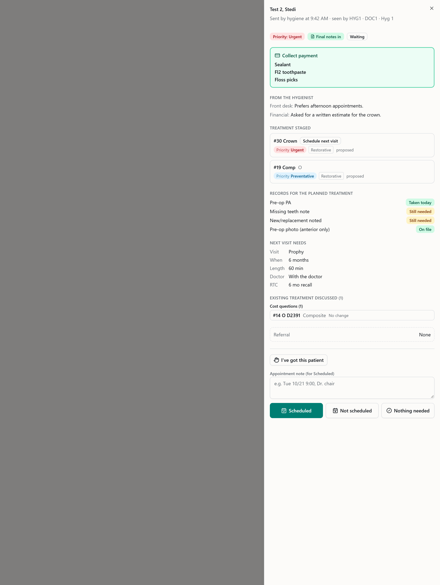
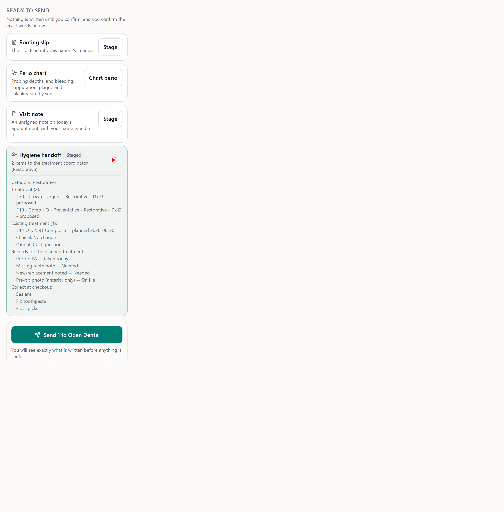
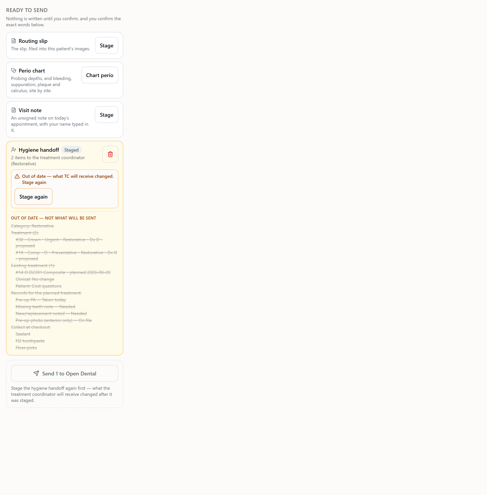
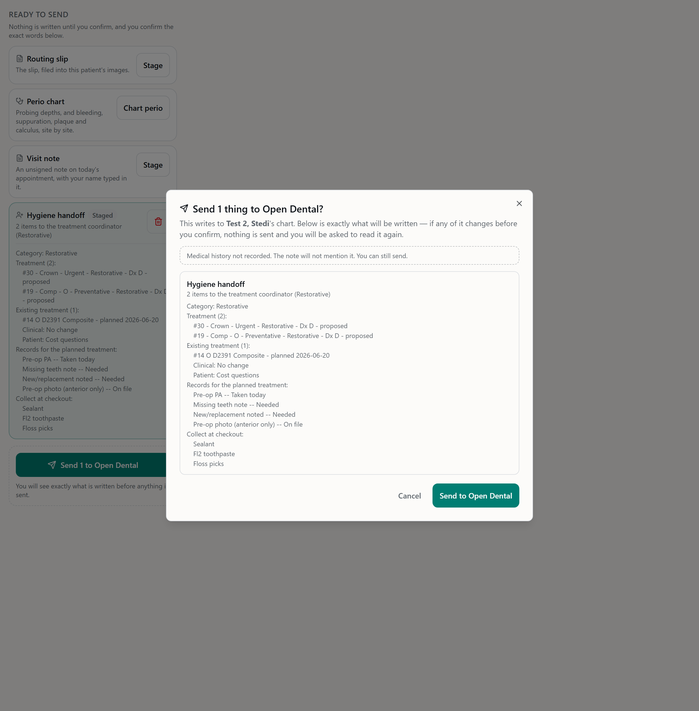

# Checkout v2 + medical history — report

Branch `feature/hyg-checkout-v2`, PR #284 to `develop`. Not merged.
Ratified by Beau 2026-10-28. **No fees, balances or other financial reads from Open Dental anywhere** — and no new Open Dental read or write path of any kind.

## What changed, by ruling

### 1. Medical history update (slip + note)

- **The slip.** A "Medical history update" row sits directly after the visit-type picker, whatever the type. It has a **No changes** chip and a box for what changed (max 1000).
  - **One answer, never two.** Tapping No changes empties the box, and typing un-picks No changes; both happen visibly. Clearing the box back to blank means unanswered, not an empty "changes".
  - **It says what it will print.** The line under the row reads `The note says: "…"`, or "Not recorded yet — the note prints no medical-history line."
- **The note.**
  - **Answered:** it prints `Medical history: reviewed, no changes` or `Medical history update: <text>`, right after the template's opening line. The generic note, which has no template, prints it as its first line.
  - **Unanswered:** no line is printed, and the Router never prints it.
  - The line is added by the composer, not written into the shared templates. That keeps the templates matching the practice's auto notes, and the parity test is untouched.
- **Send.** The confirm shows "Medical history not recorded. The note will not mention it. You can still send." Send stays enabled.
- **Old slips.** The field is `.nullable().default(null)` on the slip's jsonb, the same load-bearing rule the slip already follows. A slip saved before this branch parses as unanswered. No migration was needed for the slip.
- **Staleness, on this field only.**
  - The staged note's payload carries `medicalHistoryDigest`, a hash of exactly the line it printed.
  - **Changing the answer** marks the note out of date (`staleReason: medical_history`), and the Send refuses it with `PREVIEW_CHANGED`.
  - **Any other slip field** still leaves a staged note as it was. The general fix is the separate queued item.

### 2. Collect at checkout

- **The slip.** Chips for Sealant, Fl2, Whitening gel, Mouthwash and Fl2 toothpaste, plus an **Other** box (max 200). They are stored in the option order, so the same answer is always the same value.
- **Carried on both paths, as labels.** A checkout is a snapshot, never a reference.
  - **The checkout alert,** both the early alert and the visit Send's final update, sends `snapshot.collectAtCheckout`, e.g. `["Sealant", "Fl2 toothpaste", "Floss picks"]`.
  - **The TC handoff (case intake)** sends `collectAtCheckout`, plus `records` after review. They are stored on `tc_hygiene_intakes.collect_at_checkout` and `records_needed`, nullable jsonb arrays (migration `1793300000000_tc_hygiene_intake_collect`, above develop's newest `1793200000000`).
- **Availability** (as amended by the fix round, below). Two questions, answered separately:
  - **Can checkout be sent?** Always. The checkout alert (early, and the visit Send's final update) carries the collect list whenever there is one.
  - **Does it create a TC case?** Only with treatment items or a TC-actionable existing answer. A collect item alone does **not**. The same rule is used in three places: the composer at stage, `tcHandoffClient.buildIntake` at send, and `visitProgress`'s tc step on the day card.

  | items | TC-actionable answer | collect item | checkout alert | TC case (stage / send) | day card tc step |
  | --- | --- | --- | --- | --- | --- |
  | – | – | – | sent, no list | refused | not applicable |
  | – | – | ✓ | sent, carries list | **refused** — no case | not applicable |
  | – | ✓ | – | sent, no list | ✓ | to do |
  | – | ✓ | ✓ | sent, carries list | ✓, carries list | to do |
  | ✓ | any | – | sent, no list | ✓ | to do |
  | ✓ | any | ✓ | sent, carries list | ✓, carries list | to do |

  All eight combinations are pinned in `checkoutV2.test.js`.

### 3. Checkout panel v2 (TC checkout sidebar)

The panel uses only data CareIN already holds; there are no new Open Dental reads.
- **Collect payment, at the top** in a prominent green box, when the snapshot has a collect list.
- **"From the hygienist":** the front-desk note and the financial note as their own section. Before, they were a footnote under everything else.
- **Priority distinct from category.**
  - **Priority** is now a filled, coloured pill that says "Priority Urgent": red for urgent, blue for preventative, violet for cosmetic.
  - **Category** is now a plain outlined tag ("Restorative").
  - The header chip reads "Priority: Urgent". Before, a coloured "Preventative" chip sat beside the code over a grey "Restorative · proposed" line, and read as if it were the category.
- **Records for the planned treatment,** each with its status ("Still needed" in amber, "Taken today" or "On file" in green).
  - **Premise correction:** the spec said these were "already carried". They were not. They were only on the Router and the handoff preview, never on the checkout snapshot.
  - The snapshot now carries `records`, derived the way the Router derives them: `RECORDS_MATRIX` over the items, plus the slip's recorded status.
- **Existing treatment** is unchanged.
- **Older snapshots** have none of the new keys and render exactly as they did, with no empty sections.

The panel, from synthetic data. The dark-mode versions sit beside each file.



### 4. The handoff preview is what TC receives

- **What it prints now.** The staged handoff card used to print a fixed line where the existing answers would go ("Existing treatment answers go with it, as they stand when it is sent"), because nothing told the hygienist when they changed. It now prints everything TC receives:
  - the treatment items;
  - the existing items and their answers (exactly the ones the send carries, through the send's own filter, `existingTxForTc`);
  - the records;
  - the collect-at-checkout list.
- **Out of date when any of that changes.** The server recomposes the handoff from what is stored and compares its fingerprint with the stored preview (`staleReason: handoff`). The tray shows "Out of date — what TC will receive changed", and the Send refuses with `PREVIEW_CHANGED`.
  - Nothing in that preview depends on the viewer or the clock, so the comparison is exact.
- **One decision, two callers.** `existingTxStale.staleReason` decides for both the tray's flag and the Send's refusal, so the two cannot disagree.
- **Field names.** The flag keeps its name (`existingTxStale`), and the new `staleReason` says which of the three reasons applies.
- **Handoffs staged before this deploy** read out of date once and need one "Stage again". Their preview never showed the answers, so they really are out of date.

Sample handoff preview, from test data (`roland 12827`), exactly as the composer writes it:

```
Category: Restorative
Treatment (2):
  #30 - Crown - Urgent - Restorative - Dx D - proposed
  #19 - Comp - O - Preventative - Restorative - Dx D - proposed
Existing treatment (1):
  #14 O D2391 Composite - planned 2026-06-20
    Clinical: No change
    Patient: Cost questions
Records for the planned treatment:
  Pre-op PA -- Taken today
  Missing teeth note -- Needed
  New/replacement noted -- Needed
  Pre-op photo (anterior only) -- On file
Collect at checkout:
  Sealant
  Fl2 toothpaste
  Floss picks
```

The staged handoff in the hygiene tray, current and then out of date after the collect list changed. Last, the Send confirm with the medical-history reminder:





To regenerate: `pnpm exec vite build`, then `TC_SHOTS=1 pnpm exec vitest run tests/tc-checkout-v2-shots.test.tsx`, then `node scripts/shoot-tc-checkout.mjs`.

## Guardrails

- **No new Open Dental paths.**
  - No new Open Dental read or write. The note and the Router reach Open Dental only through the approved Send, and the TC handoff and checkout alert are the existing loopback calls into TC.
  - The staging fixture gate is untouched, and `hygNoOdWrites` is green.
- **Office and PatNum are server-derived.** Everything new is read from the stored visit row, never a request body.
- **No `SELECT *`.** The progress count is computed in SQL, so nothing of the slip (not even the free-text Other) leaves the database there.
- **Additive only:**
  - optional snapshot keys (`collectAtCheckout`, `records`);
  - an optional, nullable intake field and column;
  - defaulted slip fields;
  - an optional `medicalHistoryDigest` on the note payload;
  - an optional `staleReason` on the visit response.
  
  Old payloads parse, and that is pinned on both sides.
- **No real patient or staff names** in the new code, tests, this report, the PR or the commit. Test data is roland 12827 / 12828 and synthetic hygienist emails.
- **TS strict,** no `any`, `tsc` clean. Both contract bundles were regenerated with the pinned esbuild, and the byte-compare test passes.
- **Existing test expectations changed,** each one labelled `RULING (checkout v2)`:
  - **`hygExistingTxCompact.test.js`:** an answer saved after staging now marks the handoff out of date too (it used to pin "never the handoff"). This is the premise update ruling 4 makes.
  - **`hyg-visit.test.tsx`:** the empty handoff card's copy now names the third way out ("or add something to collect at checkout").
  - **`tc-checkout.test.tsx`:** the sheet's header chip reads "Priority: Urgent".

## Review

A fresh-context reviewer ran two rounds.

**Round 1: no critical findings, 1 HIGH, 3 MEDIUM, 4 LOW.**
- **H1, fixed.** The handoff preview listed the records, but the TC case intake did not carry them; only the checkout alert did. The intake now carries `records` as well: a nullable `records_needed` column in the same migration, wired through the case store, the rows mapping and the route. A test checks the preview and the intake body list the same records.
- **M2, kept and documented.** Handoffs staged before the deploy read out of date once (see "For Beau").
- **M3, fixed.** The preview and the out-of-date check ran the send's filter on every visit read and logged each time. They are now quiet; only a send logs.
- **M4, fixed.** The medical-history box now follows a stored answer that changed under it, such as after a reload, unless she is typing in it.
- **L5, fixed.** The day card's SQL counted a whitespace-only "Other" that the composer would not. SQL now uses `~ '[^[:space:]]'`, and the slip trims "Other" when it is saved.
- **L6, fixed.** The medical-history reminder shows only when a note is in the Send.
- **L7, kept.** The tray reads the unsaved draft for availability. A refusal from the server is still honest.
- **L8, as ratified.** The medical history makes only the note go out of date.

**Round 2: approved.** The reviewer confirmed the preview and the intake body draw on the same data for all four parts: the items, the existing answers, the records and the collect list.

## Tests

```
backend  node --test                       tests 4374, pass 4371, fail 0, skipped 3
           checkoutV2.test.js               18  both medical-history answers, unanswered, generic note, old-slip parse,
                                                staleness on that field only (and a legacy note), collect on both paths
                                                (+ TC schemas take it), old TC payloads parse, the 8-row availability
                                                truth table (stage / send / day card), collect-only handoff, records on
                                                the snapshot (+ status vocab matches), the exact sample preview, handoff
                                                staleness per input, pre-deploy handoff, records on the intake
           hygCheckoutV2.test.js            5   route-level: medical history to note, stale on that field only, Send
                                                refuses; collect-only stage + send; checkout alert carries collect +
                                                records; handoff stale + refused, nothing reaches TC; day card tc step
           tcCheckoutV2.test.js             3   intake stores collect + records (null when absent), malformed refused,
                                                snapshot carries both and an old snapshot still parses
dashboard pnpm run check (tsc)              clean
          pnpm run test                     Test Files 196 passed | 40 skipped; Tests 2994 passed | 228 skipped
           hyg-checkout-v2.test.tsx         11  field placement, the two answers clear each other, collect chips order
                                                + Other cap, tray availability, reminder never gates, stale reasons, panel
                                                order, priority vs category, urgent is red, old snapshot renders as before
           tc-checkout-v2-shots.test.tsx    3   screenshot dumps (TC_SHOTS=1)
```

Backend runs on Node 22 now and then show a file-level `not ok` on an untouched file (`sendToTc.test.js` or `onDemandTranscription.test.js`). Each passes on its own. It is the known runner flake, and the final full run above has 0 failures.

## For Beau

1. **Re-stage in-flight handoffs once after deploy.** A handoff staged before the deploy shows "Out of date" once. One "Stage again" fixes it.
2. **Records were not previously carried to checkout.** Now they ride both the checkout alert and the TC case intake (see 3).
3. **A collect-only visit opens no TC case** (fix round, below). It reaches the desk on the checkout alert only, so an office with checkout alerts switched off has nothing that tells the desk what to collect for such a visit; the tray says so in amber.
4. **Pre-existing, not touched here:** last round's merged route test `hygFeedbackRound1.test.js` (and the parity fixture) use the configured doctors' real names as test data. That's against the no-staff-names rule. This slice may change existing test expectations only where its rulings require, so I left them; they are worth swapping for a synthetic roster in a follow-up.

## Fix round (PM review, 2026-10-28)

**Ruling:** a collect-only visit — no treatment items, no TC-actionable existing answer, ≥1 collect item — sends the **checkout alert only**. It must not create a TC pipeline case. A visit with collect items *and* case-worthy content behaves as before: a case and a checkout alert, both carrying the list.

**What changed**
- **Composer** (`stagedWriteComposer.js`): the TC handoff is refused again whenever there is no treatment and no TC-actionable answer, whatever the collect list says. A collect-only refusal names where the list goes: "What to collect at checkout goes to the front desk on the checkout alert, not in a TC case." The collect-only summary line is gone.
- **Send** (`tcHandoffClient.buildIntake`): the same refusal, restored to develop's wording. The case body still carries `collectAtCheckout` whenever a case is sent.
- **Visit Send**: unchanged code path. With no handoff staged, no case intake is attempted, and the checkout alert's final update (which rides every Send) carries the list. Pinned end to end: a collect-only visit sends its note, the checkout alert arrives with `["Fl2 toothpaste"]`, and the TC case submitter is never called.
- **Day card** (`visitProgress.js`, `progressStore.js`): restored to develop. A collect-only visit's tc step is *not applicable*, and the collect-count query added earlier in this PR is removed along with its test fake.
- **Tray**: for a collect-only visit, the TC handoff card gives way to a **Checkout alert** card (`hyg-staged-checkout-alert`). It reads "No treatment for TC today, so no case is opened. The front desk gets what to collect payment for (N) on the checkout alert — with Alert checkout, and again with Send." There is nothing to stage on it. If the office has checkout alerts off, the card says so in amber. The empty-handoff copy is back to develop's wording.
- **No migration change.** `1793300000000` stays as it was; the case intake's `collect_at_checkout` column is still used when a case carries the list.

**Tests, labelled `RULING (checkout v2 fix)`**
- `checkoutV2.test.js`: the truth table now splits *can send checkout* (every row) from *creates a case* (treatment or actionable answer only), and checks both bodies carry the list when both go. The collect-only test now pins the refusal and the checkout body.
- `hygCheckoutV2.test.js`: the collect-only route test now proves no case and the alert on Send. A new test proves collect + treatment sends both with the list. The day-card test now expects *not applicable*.
- `hyg-checkout-v2.test.tsx`: the tray test now expects the Checkout alert card (on and off) for collect-only, and the TC handoff card once there is treatment.
- `hyg-visit.test.tsx`: the earlier `RULING (checkout v2)` copy edit is reverted to develop's original expectation, since the copy is develop's again.

**Runs:** backend `node --test` 4,355 pass, 0 assertion failures; one file-level `not ok` on the untouched `sendToTc.test.js` (the known Node 22 runner flake), which passes 18/18 on its own. Dashboard `tsc` clean; vitest 196 files, 2,994 tests passed.
