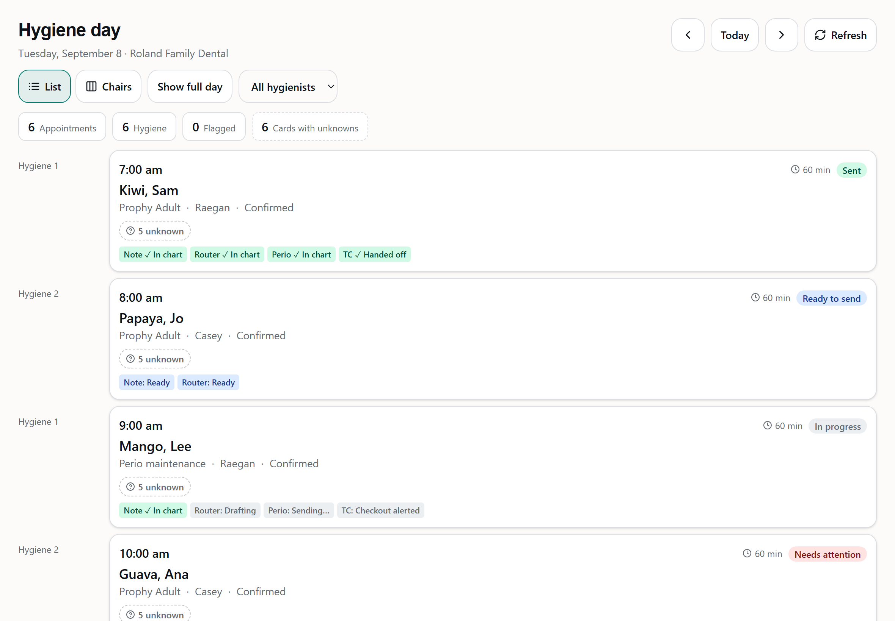
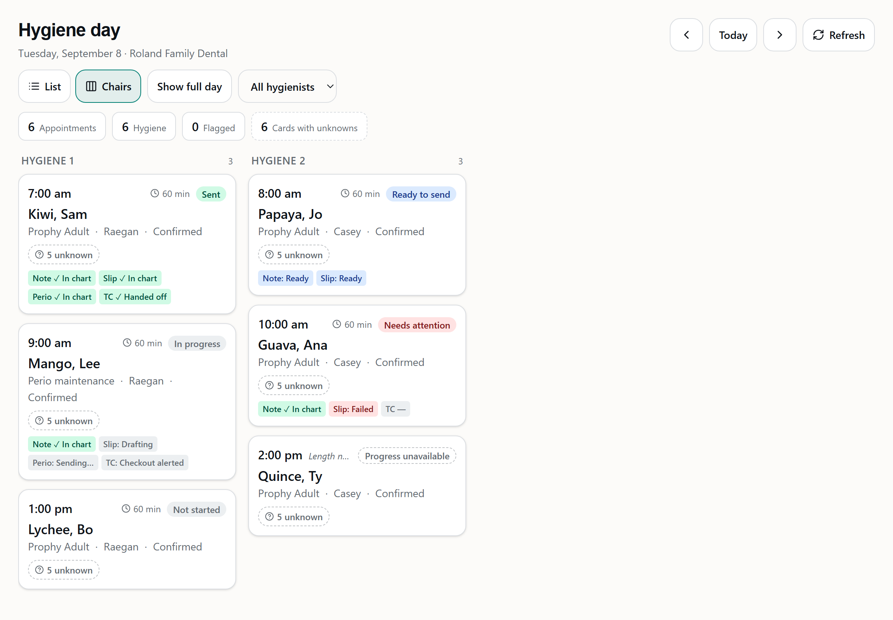
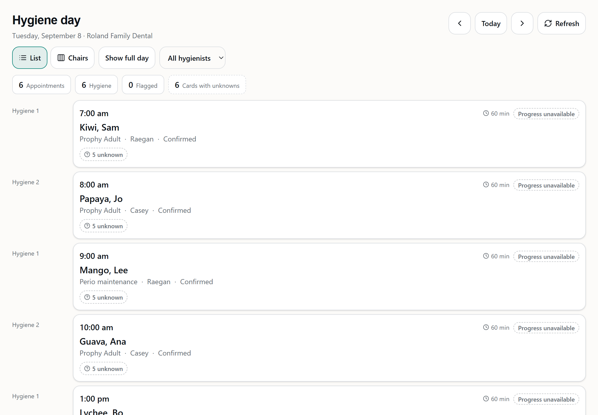

# Hygiene queue item: day-card visit progress pill

Branch `feature/hyg-day-progress` off `origin/develop` (`096e23a`), worktree
`C:\Users\beau\carein-wt\hyg-day-progress`. **PR #275 → develop, not merged.**

## What it does

Each card on `/hyg/day` now shows one summary pill on the time row. Up to four step chips
sit under the card, so a hygienist or OM can see at a glance which visits are done.

| Overall | Pill | Tone |
| --- | --- | --- |
| no `hyg_visit` row | Not started | neutral |
| any step failed | Needs attention | red |
| every applicable step `Written` | Sent | green |
| any step ready, none drafting/sending | Ready to send | blue |
| anything else | In progress | neutral |
| read failed, or AptNum missing from the answer | **Progress unavailable** (dashed) | none, because it is not a state |

The step chips are always words, never an icon alone or hover text:

- `Note ✓ In chart` and `TC ✓ Handed off`
- `Slip —`, with "not started" for screen readers
- `Perio: Drafting`, `Perio: Sending…` and `Perio: Ready`
- `Slip: Failed`
- `TC: Checkout alerted`
- Steps that do not apply to the visit are hidden.

## Backend

| File | Change |
| --- | --- |
| `backend/routes/hyg/day.js` | New `GET /api/hyg/day/progress?office=&apt=`, under the same `requireModule('hyg')` + `requireReadWrite` + `requireOffice` chain as `/day`. Returns 400 `INVALID_APT_NUMS` if the AptNums are not all positive integers. They are deduped, then capped at 200. A repeated `?apt=` is also refused. A read over 500 ms writes a `[hygprogress] SLOW` line. |
| `backend/services/hyg/progressStore.js` | Four fixed SELECTs with explicit columns. Every WHERE starts `office = $1`. Tables read: `hyg_visit`, `hyg_staged_write` (kind, state, whether `error_message` is set), the latest non-deleted `hyg_perio_send`, and a COUNT of `hyg_treatment_item`. |
| `backend/services/hyg/visitProgress.js` | The pure derivation, plus `parseAptNums`. |
| `new-dashboard/shared/hyg/contract.ts` | `HygStepStateSchema`, `HygVisitOverallSchema`, `HygVisitProgressSchema` and `HygDayProgressResponseSchema`; `INVALID_APT_NUMS` added to `HYG_ERROR_CODES`. |
| `backend/hyg/contract.gen.cjs` | Regenerated with the pinned esbuild and `--alias:zod`. The change is purely additive. |

**Honest states.** `written` comes only from staged state `Written`, which visitStore reaches
only after a read-back. A perio send row can push perio to `sending` while one is in
flight. It can never promote a step to `written`. `checkoutAlerted` is shown beside the TC state,
never instead of it, so a failed handoff still reads "Failed".

**No PHI, no audit row.** The response carries AptNums and states only. The office
isolation test checks that no PatNum or name appears anywhere in the body. Nothing about a
patient is disclosed that `GET /day` has not already disclosed and audited, so this
route writes no audit row.

**Zero Open Dental.** The route never resolves an OD handle. `hygNoOdWrites.test.js` has a
new case: driving the route to 200 makes no OD write **and no OD read**
(`od.calls` is empty). The source scan and its allow-list are unchanged.

## Deviation: TC is `not_applicable` when there is no treatment

You accepted this on 2026-10-26.

**The rule:** TC is `not_applicable` when the visit has **zero `hyg_treatment_item` rows and
no tc-handoff row**. A handoff row with zero items stays applicable.

**Why:** `stagedWriteComposer.js` refuses a handoff for a visit with no treatment ("An
empty case in a treatment coordinator's queue is worse than no case"). Without this rule, a
no-treatment visit could never read "Sent".

**What it costs:**
- A fourth read: a COUNT keyed by office + visit_id, CareIN Postgres only, no item contents.
- "Sent" can honestly go back to "In progress" if treatment is added afterwards. That case is pinned too.

**Table rows that pin it** (`backend/services/hyg/visitProgress.test.js`):

| Row | Input | Result |
| --- | --- | --- |
| (a) | zero items, note and slip `Written`, no perio | `sent` |
| (b) | zero items, note `Written`, slip `Staged` | `ready_to_send`, not `sent` |
| (c) | zero items, no writes at all | `in_progress`, never `sent` |
| (d) | items present, no tc-handoff row | TC `none`, overall `in_progress` |

On (c): note and slip are always applicable, so steps that do not apply can never make a
visit "Sent" on their own.

## Frontend

| File | Change |
| --- | --- |
| `client/src/features/hyg/progress.ts` | Labels, tones, step marks, `cardProgressFor`, `progressAptNums`. |
| `client/src/features/hyg/api.ts` | `fetchDayProgress`, which parses the response through the zod schema. |
| `client/src/features/hyg/AppointmentCard.tsx` | `ProgressPill` on the time row (`whitespace-nowrap shrink-0`; the length text is what gives way) and `StepMarks`. These are plain spans, so the card is still one `<Link>` with `min-h-[88px]`. |
| `client/src/pages/hyg/HygDay.tsx` | Fetches progress once the day arrives, keyed on office + date + the AptNum list. When the names fill in, the page does not ask again. |

**When the page asks again:**
- on focus;
- when the page becomes visible;
- every 60s while visible;
- on Refresh;
- on remount after coming back from a visit.

A hidden page asks nothing, and nothing else polls.

**When a read fails,** every card shows "Progress unavailable" rather than the last good
answer, because a stale "Sent" is worse than no answer.

## Review

A fresh-context reviewer subagent ran one round and found no blocking bug. What was done
with each finding:

| Finding | Action |
| --- | --- |
| `DISTINCT ON` could pick either send when two share a `created_at` | **Fixed:** `ORDER BY … created_at DESC, send_id DESC`. |
| No test pinned the treatment flip, or a tc row with zero items | **Added** to the table test. |
| No test that Refresh re-asks, that a name-fill merge does not, or that a late answer for the previous day is never drawn | **Added** to `hyg-day-progress.test.tsx`. |
| The fake DB matches SQL by regex, so the real SQL was never run | **Rehearsed** against real Postgres 16. See below. |
| `ready_to_send` fires with `note: none` and `slip: ready` | **No change.** This matches the spec ("any ready and none drafting/sending"). Flagged in case you want "none" to block it. |
| "TC: Checkout alerted" shows even when TC is `not_applicable` | **No change.** It is honest, because the alert happened. Flagged. |
| One failed 60s poll flickers every card to "unavailable" | **No change.** Deliberate, per the spec. |

## Real-Postgres rehearsal

This ran against a throwaway local Postgres 16 container, which was removed afterwards. The real
control and tenant migrations ran exactly as CI runs them. The rows were synthetic: roland
12827 and valley 7115. The real `readDayProgress` connected as **`carein_app`**:

```
roland 100 in_progress {"note":{"state":"written"},"slip":{"state":"written"},"perio":{"state":"sending"},"tc":{"state":"not_applicable",...}}
roland 101 present? false
valley 100 needs_attention {"note":{"state":"failed"},"slip":{"state":"none"},"perio":{"state":"not_applicable"},"tc":{"state":"none",...}}
REHEARSAL OK
```

**What it proved:**
- All four statements parse.
- The grants reach `carein_app`.
- `bigint[]`/`uuid[]` array params and `COUNT(*)::int` behave.
- A newer `deleted` send is ignored.
- Valley sees only its own rows.

**What it did not prove:** the seeded sends had distinct `created_at` values, so the
rehearsal shows the tie-break parses but not that it resolves an actual tie.

## Test output

```
backend  node --check server.js         OK
backend  node --test                    # tests 4197  # pass 4194  # fail 0  # skipped 3
dashboard pnpm run check (tsc --noEmit) clean
dashboard pnpm run test                 Test Files 187 passed | 37 skipped (224)
                                        Tests 2872 passed | 215 skipped (3087)
```

The skipped dashboard tests are the `HYG_SHOTS`-gated screenshot suites, and this slice adds
one: `hyg-progress-shots.test.tsx`.

**New tests:**
- `services/hyg/visitProgress.test.js` (6)
- `routes/hyg/hygDayProgress.test.js` (6): roland 100 vs valley 100, zero OD calls, `not_started` and dedupe, no PHI, the 400 cases, 403 when unentitled. The response is parsed with the contract schema.
- One new case in `hygNoOdWrites.test.js`
- `tests/hyg-day-progress.test.tsx` (16): each overall state, unavailable (failed read and missing AptNum), no nested interactive elements, the pill never truncates, focus and visibility, the 60s interval with recovery, Refresh, no re-ask on name fill, a stale answer ignored.
- `tests/hyg-contract.test.ts` now checks the progress route's keys against the schema.

**CI:** PR #275 `build-test` passed in 4m58s on run 40438516198. It checked out
`refs/remotes/pull/275/merge` = `b8d9736` ("Merge d382338 into 096e23a"), so the result
covers the merge with develop. It was green on the first push; no fix pushes were needed.

## Screenshots

These are iPad landscape 1180×820, from `scripts/shoot-hyg.mjs`, in light and dark under
`docs/screenshots/hyg/`:

- `hyg-progress-01-list-1180x820-{light,dark}.png`: every overall state, list view.
- `hyg-progress-02-chairs-1180x820-{light,dark}.png`: the 288px chair columns, the narrowest a pill is drawn. "Progress unavailable" and "Needs attention" stay whole; "Length not recorded" is cut short instead.
- `hyg-progress-03-unavailable-1180x820-{light,dark}.png`: the read failed, every card dashed, schedule intact.





## Guardrails

- Did not touch the PROD folder's working tree or `.env`.
- No Open Dental reads or writes.
- No migration.
- No `normalizeCall` or call-store changes.
- Nothing deleted.
- No real patient names. The synthetic fruit names and the staging fixture PatNums are the only patient data used.

## Housekeeping

- The stale `.git/packed-refs.lock` in the main clone, dated 2026-10-07, warns on every
  git write. Commits still land.
- Because of that lock, a temporary ref `refs/tmp/pr275` (used to inspect the merge commit)
  could not be deleted. It is harmless. Once the lock is gone, remove it with
  `git update-ref -d refs/tmp/pr275`.
