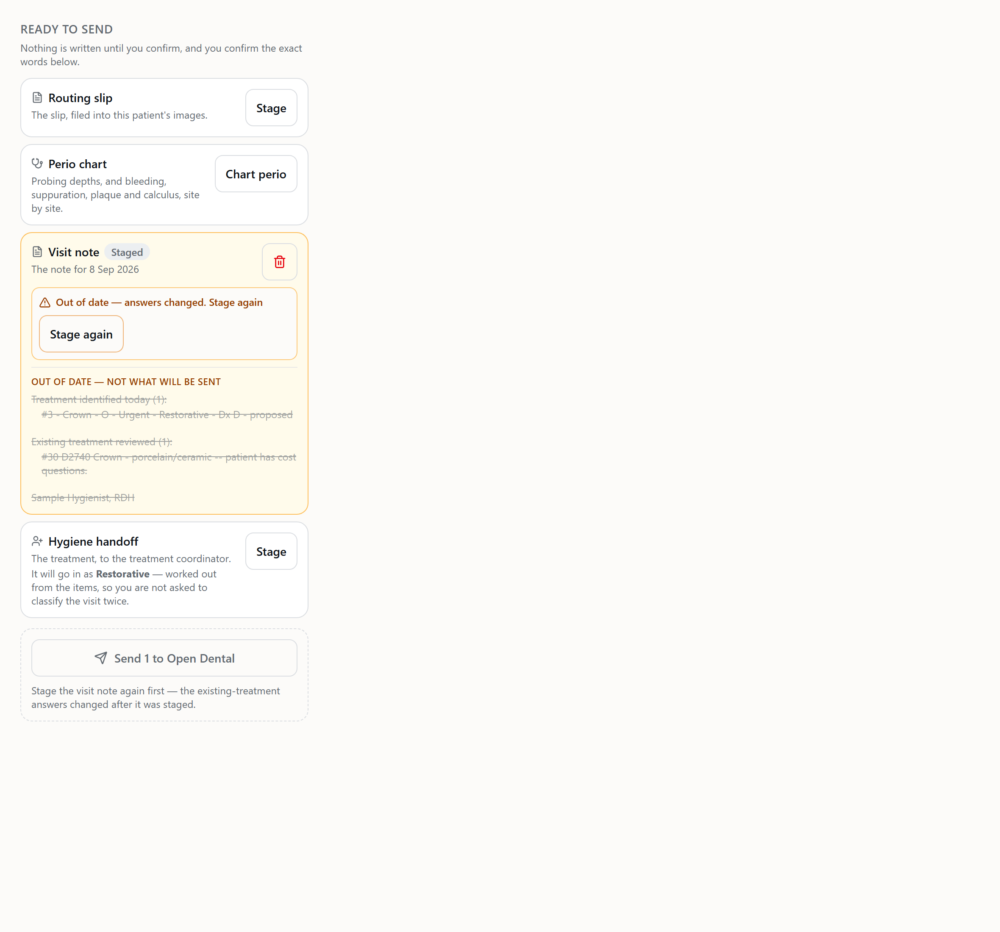
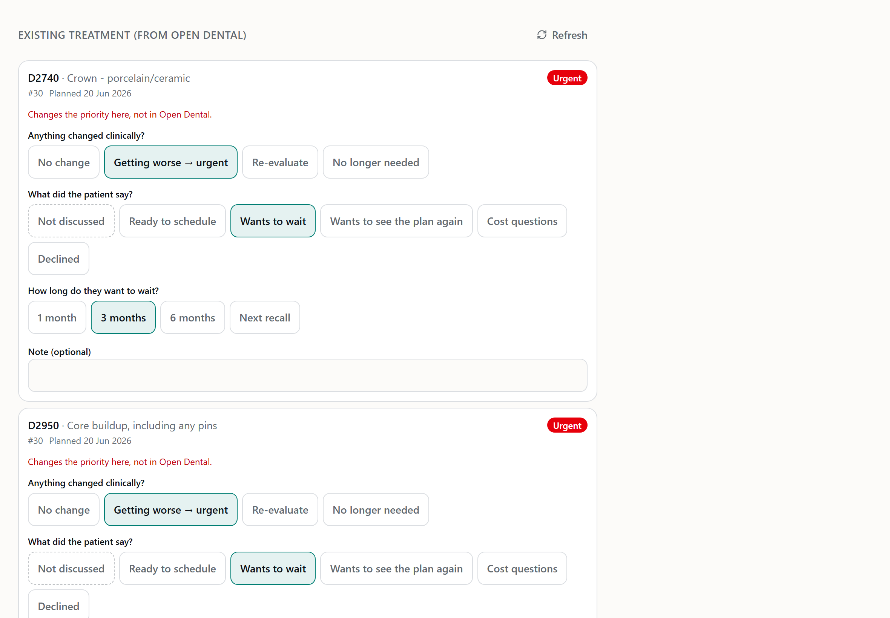
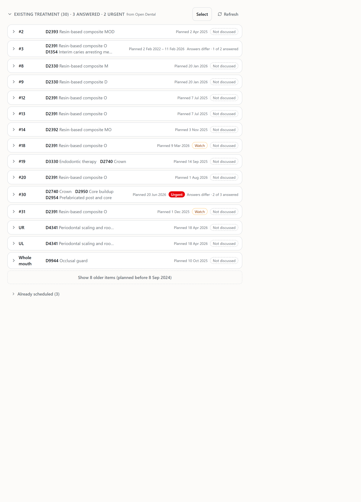
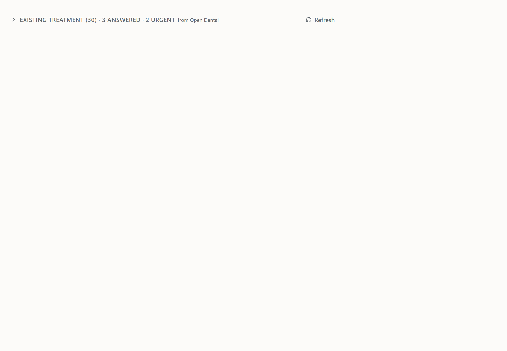
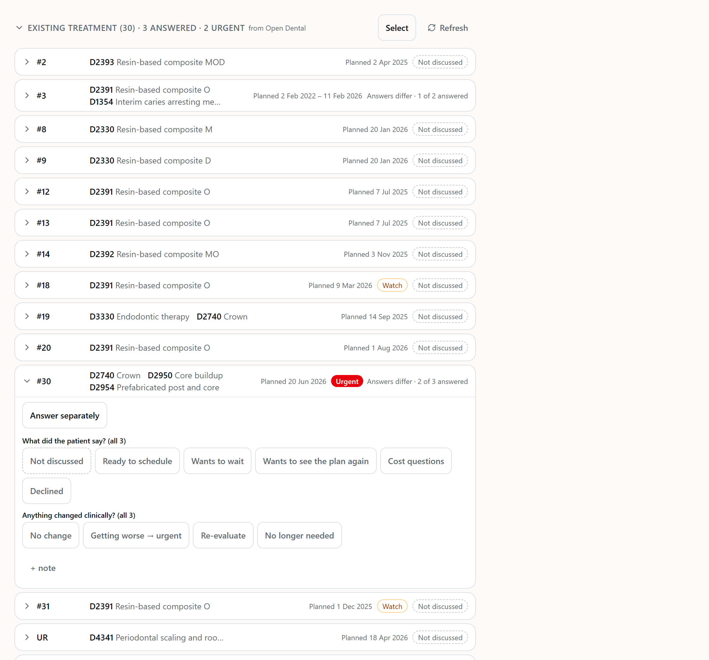
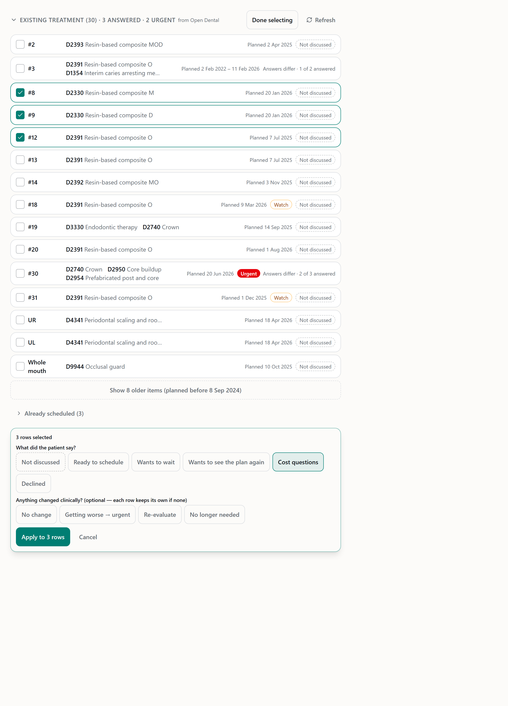
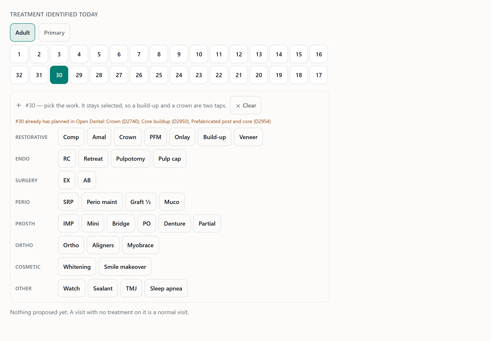

# Existing treatment: stale staging, the checkout gap, and a compact UI

Branch `feature/hyg-existing-tx-compact`, cut from `origin/develop` at `79655cd` (which
contains #279 and #280). The PR targets develop and is **not merged**. There are no
migrations, no Open Dental writes and no new Open Dental reads. Staging fixture only:
roland 12827.

## Bug 1: a staged note kept saying the old answer

**What happened.** On staging, a hygienist staged the visit note and then changed an
existing-treatment answer. The tray still said "Staged" and showed the old lines ("not
discussed with the patient"), while the chips said "Wants to wait / 3 months". Send would
have refused with `PREVIEW_CHANGED`, but nothing on screen said why.

**Fix: the server decides, on every response.**
- `backend/services/hyg/existingTxStale.js` compares each staged **note** and **Router**
  in `Staged` or `Failed` against the current answers.
  - It uses the same check `sendVisit.checkExistingTxCurrent` refuses on:
    `composer.existingTxDigest(kind, existingTxStore.loadForSend(…))`. The flag and the
    refusal cannot disagree.
- Every visit response sets `stagedWrites[].existingTxStale`. This includes the GET, slip
  saves, item edits, open, stage, the ortho send and the checkout send.
- The single answer PUT returns the staged writes read back after the save, so the tray
  flips the moment the save succeeds.
- The page never works the flag out itself. It copies the server's flag onto the matching
  row (same id, same `updatedAt`) and never replaces the list from a save's read-back.
- **The tray:**
  - The card turns amber with **"Out of date — answers changed. Stage again"** and a
    **Stage again** button.
  - The old preview stays visible but is struck through under the heading "Out of date —
    not what will be sent".
  - Send waits, and says why ("Stage the visit note again first — …").
  - A Failed row says "Retry, then stage again", because a Failed row cannot be re-staged
    directly.
- Send still refuses on the server. That is unchanged.



**Ruling: the TC handoff is never out of date.** Its preview prints no existing-treatment
lines, and its send reads the answers at send time, after its own row is claimed. Marking
it "out of date" would ask her to re-stage words that would come back identical. If you
want the handoff preview to *show* the answers TC will get, that's a small follow-up, and
it would then carry a digest like the note's.

Tests (`hyg/hygExistingTxCompact.test.js`):
- an answer saved after staging marks the note and Router, but not the handoff;
- the flag is in both the PUT response and the GET;
- the flag predicts the Send refusal;
- re-staging clears it, kind by kind;
- putting an answer back makes the note current again, because this is the digest and not a
  dirty bit;
- a Failed note is flagged, a Written one is not;
- open and item-add responses carry it too (the review-round fix).

## Bug 2: the checkout panel showed no existing treatment

**Evidence.** Everything below was read on staging, read-only, inside the running
container. A short script used the app's own secrets loader, tenant registry and tenant
pool. It printed ids, times, keys and answer values only, no names.

| Question | Answer |
| --- | --- |
| When did `79655cd` reach staging? | The staging workflow run for `79655cd` finished **2026-10-28 00:16:44Z**. Revision `ca-carein-backend--0000264`, image `carein-backend:79655cd`, was created at 00:16:17Z and is the only active revision, with 100% of traffic. |
| When was the alert? | The roland checkout handoff for PatNum 12827 was created **2026-10-28 01:11:39Z** (20:11 CDT) and updated at 01:12:16Z (`final: true`, revision 1). |
| (a) Did the alert predate the deploy? | **No.** It came 55 minutes after, on the 79655cd revision. |
| (b) Were items dropped? | **No.** The stored payload has `existingTx` with **9 items**: 2 `wants_to_wait` and 7 `not_discussed`. Not Discussed was carried, nothing was filtered, and it wasn't null. |
| (c) Did the panel not render it? | **Yes, this was the cause.** |

**Cause.** The front desk's **TC → Checkout** sheet is `CheckoutSidebar.tsx`. Slice 2b drew
the existing-treatment block only on the case view's `HygieneTreatmentPanel.tsx`. So the
data reached TC, was stored, and was parsed by the client, but no code on the sheet the desk
opens ever drew it. That is my miss from 2b: the 2b report called the wrong component "the
checkout panel".

**Fix.** The sidebar now renders the same `ExistingTreatmentFromHygiene` block:
- every carried item, **including Not discussed**;
- in the ratified order: Ready to schedule, See plan again, Cost questions, Wants to wait
  (with its timeframe), Declined, Not discussed;
- Urgent as a red pill, and "Already scheduled".

A snapshot from before 2b shows no section at all, never an empty one.

**Regression test.** `tests/tc-checkout-sidebar-existing-tx.test.tsx` feeds the staging
shape (9 items, 2 wait, 7 not discussed) through the real `TcCheckoutHandoff` schema. It
**fails without the fix** and passes with it.

The 20:11 alert is already stored with its 9 items, so the desk will see them on that
handoff once this deploys. Nothing needs re-sending.

## UX: compact existing treatment

Frontend, plus one bulk route. No schema change.

- **Grouped by tooth set.** This reuses `groupByTooth` and `toothGroupLabel` from
  `TreatmentItems.tsx`; `groupByTooth` is now generic.
  - Rows are in tooth order. Quadrant and arch items with no tooth (UR, UL…) come next, and
    the **whole mouth comes last**.
  - Each group is **one collapsed row** showing:
    - the tooth;
    - each procedure as code plus short description ("D2740 Crown");
    - the planned date, or a range;
    - **Watch** and **Already scheduled** badges;
    - the answer summary: a red **Urgent** pill, then "Wait 3 mo", or a dashed
      **Not discussed**, or "Answers differ · 2 of 3 answered".
- **Tap a row to open its editor in place.** This is an accordion, one row open at a time.
  - The answer applies to **every procedure in the group** through one atomic bulk save.
  - **Answer separately** splits it per procedure.
  - The patient question comes first and the clinical one second. Chips are `text-sm` and
    `min-h-11`.
  - The note sits behind **+ note**.
  - Last-discussed lines are inside the editor.
- **The default view.**
  - It shows everything planned within 24 months of the visit date, plus anything on Watch,
    urgent or answered, whatever its age.
  - Older items sit behind **"Show N older items (planned before <date>)"**.
  - Already-scheduled items sit behind a collapsed **"Already scheduled (N)"**.
  - An item with **no planned date is shown**, because "not recorded" isn't "old".
- **The header** reads "Existing treatment (N) · X answered · Y urgent · from Open
  Dental". It is collapsible, and opens by itself when N ≤ 8.
- **Select.** Tick rows, pick one patient answer and, optionally, one clinical answer, then
  Apply. This goes through the bulk route.
  - Without a clinical pick, each row keeps its own clinical answer.
  - The timeframe applies only with Wants to wait.
  - Select is hidden once the visit is frozen.
- **The duplicate hint** in "Treatment identified today". While a tooth with OD-planned
  procedures is picked, it shows "#30 already has planned in Open Dental: Crown (D2740),
  Core buildup (D2950)". It never blocks an add, and the test adds a crown right after.
- **Structure.** Rows are divs, with a full-width button for the row and buttons inside the
  editor. No interactive element is nested in another. That is tested.

### PUT /api/hyg/visit/:aptNum/existing-tx (the bulk answer)

The body is `{ items: [{ procNum, clinical, patient, waitTimeframe, note }] }`. It must have
1–200 items with unique ProcNums, and it is strict: an `office` or a PatNum in the body is a
400.

It has the single PUT's guards for every row:
- The office and PatNum come from the stored visit.
- **Any ProcNum not in this visit's Open Dental read rejects the whole batch with 404**.
- A frozen visit gets 409, checked first and again inside the write.
- The snapshot of each procedure is the server's own.
- It writes one `UPDATE hyg_existing_tx` audit row per procedure, exactly as the single
  PUT does.

`existingTxStore.saveDispositions` is **one statement**: the single save's `FOR SHARE`
freeze guard plus `INSERT … SELECT FROM jsonb_to_recordset … ON CONFLICT DO UPDATE`. That
makes it atomic without a transaction.

**Rehearsed on real Postgres 16 as `carein_app`.** All of these passed:
- insert, then update;
- one CHECK-violating row refuses the batch and writes nothing;
- a duplicate ProcNum is refused;
- the staleness read flips after a bulk answer;
- a frozen visit writes nothing;
- a bulk write **waits on an in-flight send's row lock**, then refuses.

### Before and after

The same synthetic 30-item plan in both, at iPad landscape (1180×820) and the visit's
768px main column:
- 18 recent items on 12 teeth, 2 on Watch, 3 answered (2 urgent), 3 already scheduled, and
  8 older than 24 months.
- No patient appears anywhere.

**Before (79655cd).** One full card of chips per procedure. About 1.5 items fit on an iPad
screen, so 30 items run to roughly 15–20 screens.



**After, default view.** All 15 recent rows, "Show 8 older" and "Already scheduled (3)" fit
in about **1.2 screens** (≈ 970 CSS px). The two-screen frame below has room to spare.



**After, other states.**

- **Closed.** More than 8 items, so the header alone shows:

  

- **#30 open, answered together:**

  

- **Select, three rows ticked:**

  

- **The duplicate hint:**

  

Dark variants of every shot are beside them in `docs/screenshots/hyg/`. They are produced
by `tests/hyg-existing-tx-compact-shots.test.tsx` (`HYG_SHOTS=1`) and
`scripts/shoot-hyg.mjs`. The "before" was rendered from 79655cd's component with a
throwaway, uncommitted copy.

## Rulings that changed existing tests (each labelled `RULING (compact round)` in code)

`tests/hyg-existing-tx.test.tsx` was changed only where this round changed behavior.

**Interaction**
- Rows start collapsed, so tests open the row before tapping.
- The note is behind "+ note".
- A frozen row still opens, so it can be read, and its "+ note" button is locked.

**Layout and grouping**
- Watch is a badge, not a separate list, and rows are in tooth order. The test now pins the
  badge and the order.
- A scheduled item sits under "Already scheduled".
- The heading carries the counts, and "from Open Dental" moved beside it.

**Test harness**
- The mocked save returns `stagedWrites`, as the real contract now does.

All 22 of the file's tests still pass. No backend expectation changed. The backend test
fake gained the bulk statement and the digest read.

## Guardrails

- **No Open Dental writes.** The new tests assert `od.writes` is empty.
- **No new Open Dental read paths.** The bulk route uses #279's `readExistingTxFor`, which is
  cached.
- **No migration.**
- **No `SELECT *`.**
- **Office and PatNum** come from the stored visit. The bulk body is strict and refuses
  either one.
- **TypeScript is strict, with no `any`.** `tsc` is clean. Both contract bundles were
  regenerated with the pinned esbuild.
- **No real patient names.** The data is synthetic plus the 12827 and 7115 fixtures. The
  Bug 2 evidence printed no names.

## Review

A fresh-context reviewer ran two rounds.

**Round 1: no critical findings, 2 HIGH, 3 MEDIUM, 3 LOW.**
- **HIGH:** slip, open, item, ortho and checkout responses returned the visit **without**
  the flag. The page replaces its visit on those responses, so the next slip edit would
  have cleared "Out of date" and re-enabled a Send the server refuses.
  - Fixed: all 16 response sites now go through one annotating `viewPayload`.
  - A regression test fails without the fix.
- **HIGH:** the fixture appeared uncommitted. This was a snapshot artifact; it was committed
  in `d47d28f`.
- **MEDIUM**, all fixed:
  - A save's read-back could overwrite a concurrent stage. The page now copies flags only
    onto the same row.
  - A flag could land on a row that moved to Sending between two reads. The row's own state
    is now checked.
  - The staleness read pulled whole payloads. It now reads the digest only.
- **LOW**, left as they are:
  - A stale Failed note needs Retry and then Stage again, which is one extra tap.
  - If one save fails, a save queued behind it still carries that save's change. This is
    pre-existing per-row behavior from 2a.
  - The 24-month cutoff is computed from the date's digits, so 29 Feb maps to "29 Feb" two
    years back. String ordering is still correct.

**Round 2: approved.** No critical, high or medium findings. It confirmed:
- `viewPayload` cannot skip a visit that needs annotating, because flags are all-or-none per visit;
- no bare `visitPayload` remains;
- the flag merge has no lost-row or rewind ordering;
- the digest read still agrees with the Send refusal.

## Tests

```
backend  node --test                       pass 4262+, fail 0 (full run; hyg files 488/488 after the review fixes)
           hygExistingTxCompact.test.js     11/11  stale per kind, re-stage clears, digest not dirty-bit,
                                                   Failed/Written, every response carries it, bulk: one
                                                   statement + audits, 404 on a stranger ProcNum, 409 frozen,
                                                   409 on a send mid-request, 400s, office from the stored visit
dashboard pnpm run check (tsc)              clean
          pnpm run test                     2930+ passed (one RCM shell test timed out once under full-suite
                                            load; 3/3 green alone, untouched by this branch)
           hyg-existing-tx-compact.test.tsx    15/15
           hyg-existing-tx.test.tsx            22/22 (rulings above)
           tc-checkout-sidebar-existing-tx     2/2   (Bug 2 regression; red without the fix)
```

## For the PM

1. **The handoff preview** doesn't show the existing-treatment answers TC will receive.
   It's honest, because it never claims to, but you may want it shown. That needs a small
   follow-up, and the handoff would then go stale like the note does.
2. **The 24-month window** counts back from the visit date. Unknown dates are always shown.
   Say if you'd rather 12 or 36 months.
3. **Select** applies a patient answer to every ticked row and leaves notes alone. A bulk
   note was deliberately left out, because the same sentence on twelve procedures is rarely
   right.
