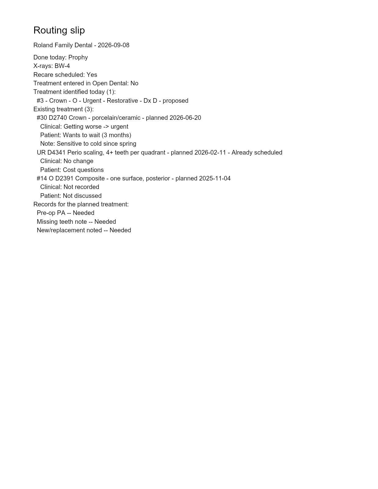

# Hygiene Slice 2b: existing treatment → note, Router, TC

Branch `feature/hyg-existing-tx-send`, cut from `origin/develop` at `e88f59e` (which
contains #279). The PR targets develop and is **not merged**.

## What it does

The answers recorded in Slice 2a now leave the hygiene module three ways. All three are
built **server-side** from the stored dispositions and each one's own `proc_snapshot`.
Nothing comes from the client.

**1. The auto note** (`stagedWriteComposer.js`)
- A new section, "Existing treatment reviewed (N):", follows the "Treatment identified today"
  block and comes before the typed-name block.
- It has one line per item where the patient's answer isn't *not discussed* or a clinical
  answer is set. **Not-discussed items are omitted**, and there is no section when N = 0.
- The lines are in the staged **preview** she approves, and that preview *is* the GroupNote
  text.

**2. The Router** (composed in `stagedWriteComposer.js`, rendered by `slipPdf.js`)
- An "Existing treatment" section lists **every** item, including Not discussed. Each item
  shows both answers, the timeframe, the note and "Already scheduled".
- It is honest about the state of the plan:

  | Plan state | Router prints |
  | --- | --- |
  | never loaded, nothing answered | no section |
  | the read failed | "Existing treatment could not be loaded from Open Dental." |
  | loaded, nothing planned | "Existing treatment: none planned in Open Dental." (only a successful read may say "none") |
  | failed or unrecorded, but some items answered | those items, under a line saying the full plan could not be loaded |

- `slipPdf.js` itself is unchanged. The section is ordinary composed lines.
  - The screen's arrow in "Getting worse → urgent" passes `sanitizeForOd` unchanged, and the
    PDF would have printed it as `?`.
  - So the composer writes it as `->`.

**3. TC** (`tcHandoffClient.js` → `/api/tc/hygiene-intakes`)
- Both bodies carry `existingTx[]`: the snapshot fields, both answers, the timeframe and the
  note, with no fee and no PatNum.
  - The case handoff stores it in `tc_hygiene_intakes.existing_tx`.
  - The checkout snapshot stores it in the existing `payload` jsonb.
- The checkout panel (`HygieneTreatmentPanel.tsx`) adds an **Existing treatment discussed**
  block.
  - It groups items in this order: Ready to schedule, See plan again, Cost questions, Wants to
    wait (with timeframe), Declined, Not discussed.
  - Getting worse → urgent shows as a red **Urgent** pill.
- The schema change is **additive and optional**:
  - `TcHygieneIntake.existingTx` is nullable, defaulting to null, the same shape item 33 used
    for `orthoScreening`.
  - `TcCheckoutSnapshot.existingTx` is optional.
  - A body for a visit with nothing to carry is byte-for-byte the old body.

## How "frozen, server-side" holds

- **Stage time.** The note and slip are composed from `existingTxStore.loadForSend`: the
  stored rows plus the plan the server last read. The route never reads the request for them.
- **Digest.** The note and slip payloads carry `existingTxDigest`, a sha256 of the existing-
  treatment lines that kind prints. It is optional in the payload schemas, so rows staged
  before this slice still send. The Send recomputes it from the stored rows:
  - **before any write**, which refuses the whole batch with `PREVIEW_CHANGED`;
  - **again once each note or slip is claimed**, because claiming freezes the answers. An edit
    that landed in that gap fails the row with nothing written. Retry plus a re-stage sends
    the current answers.
- **TC handoff.** It reads the answers after its own row is marked Sending.
- **Freezing.** `tc-handoff` is now a freezing kind, so the answers TC holds can't change
  afterwards. Slice 2a froze only on note and router. This is a deliberate rule change: the
  handoff now *carries* the answers.
- **Frozen snapshots.** An answered item is described by its **own `proc_snapshot`**, taken
  when it was answered. A later Open Dental edit doesn't rewrite what was discussed. A test
  covers that case: answer, change OD, refresh, stage.

### Where the plan is kept

`hyg_visit.existing_tx_read` (new, nullable jsonb, migration `1792900000000`) records the
server's last read:
- `{status:'loaded', readAt, items}` after a successful read;
- `{status:'failed', at}` when nothing has ever loaded.

It is written by the GET's own Open Dental read, keyed by the stored visit's office and id.
- It is never written once the visit is frozen. The guard uses the same `FOR SHARE` lock as
  the disposition save.
- A failure never overwrites a plan that loaded.
- An office that isn't ready records nothing.

## Sample note preview

This is a test-shaped visit with no patient name, an Adult Prophy Recall template, and three
existing items, one of them not discussed.

```
…template lines…
RTC:

Treatment identified today (1):
  #3 - Crown - O - Urgent - Restorative - Dx D - proposed

Existing treatment reviewed (2):
  #30 D2740 Crown - porcelain/ceramic -- getting worse, moved to urgent; patient wants to wait (3 months). Note: Sensitive to cold since spring
  UR D4341 Perio scaling, 4+ teeth per quadrant -- no change; patient has cost questions.

Sample Hygienist, RDH
Entered in CareIN by hygienist@carein.ai. Unsigned.
```

The third item, a Watch-group composite that nobody discussed, is omitted from the note. It
appears on the Router below.

## Router PDF

This is the real composer and the real `slipPdf`, rendered page 1, with test data only.



## Guardrails

- **No new Open Dental write path.**
  - The route test asserts that the full send makes exactly the two writes it always made:
    `/procedurelogs/GroupNote` and `/documents/Upload`.
  - `hygNoOdWrites` gains a case: staging both kinds with existing treatment reaches no write
    verb.
  - The fixture gate is untouched.
- **Existing expectations unchanged.**
  - Autonote parity and sendUnits gained cases only.
  - A pure test pins that a visit without existing-treatment data composes the same note,
    slip and PDF bytes, and builds the same TC bodies, as before.
- **Office and PatNum are derived on the server.** There is no `SELECT *` and no real patient
  name. TS is strict and `tsc` is clean.
- **Migrations** are both nullable and additive, with no defaults and no raw SQL:
  - `1792900000000_hyg_existing_tx_read` adds an object-with-status CHECK.
  - `1793000000000_tc_hygiene_intake_existing_tx` adds an array CHECK.
  - Develop's newest was `1792800000000` when pushed.
- **`caseStore` encodes the array.** It `JSON.stringify`s `existing_tx`, because node-postgres
  sends a JS array as a Postgres ARRAY literal, which a jsonb column refuses. The rehearsal
  proves both halves.

## Two of my own corrections

1. The #279 fix round said `Amending` locked the answers on the client as well as on the
   server. **The client set was missing it.** It is fixed here and pinned by a UI test.
2. A Slice 2a test pinned that a sent TC handoff does *not* freeze the answers. I changed it to
   *does*, with the reason written beside it. This is the rule change described above, not a
   weakened assertion.

## For the PM to decide

1. **Rollback.** `TcCheckoutSnapshot` is `.strict()`. After this deploys, stored checkout
   snapshots that carry `existingTx` would be **refused by the previous build's** strict
   parse. If prod rolls back past this release, the TC checkout panel would error for
   every visit sent while it was live.
   - Options: accept it, since a rollback that far is unlikely and the rows are re-sendable;
   - or ship a tolerant-reader release first;
   - or have the rollback runbook clear `existingTx` from those payloads.
   - Flagged, not changed.
2. **Staged Routers that are in flight at deploy** stage with no digest. Once the visit page
   is reopened, the plan is recorded and the Router would now print a section. Sending the old
   row then gets `PREVIEW_CHANGED`, "stage it again". That is honest, but it is a one-time
   nuisance. A plan refresh that changes Open Dental also invalidates a staged Router, which
   is correct.
3. **The case intake's `existing_tx` is stored but not yet shown.** Only the checkout panel
   renders the answers today. The TC case view could show them in 2c.
4. **The Router doesn't print "as read on <date>".** Printing it would change the digest on
   every refresh and refuse staged Routers. If you want the date, it needs to sit outside the
   digested lines.

## Review

A fresh-context reviewer ran two rounds.
- **Round 1:** no critical findings, 2 MEDIUM, several LOW.
  - The check-then-claim race is fixed by the post-claim re-check.
  - The rollback hazard is the decision above.
  - The non-locking read-record guard is fixed by taking `FOR SHARE`.
  - Silent drops of TC items are fixed: they are now logged as counts.
- **Round 2:** clean. It confirmed that no Open Dental write can happen before the post-claim re-check, and that Failed, then Retry, then re-stage is the recovery. That path is tested end to end.

## Tests

```
backend  node --check server.js   ok
         node --test               tests 4255, pass 4252, fail 0, skipped 3
           existingTxCompose.test.js      14/14  note line per answer combo, not_discussed omitted, N=0,
                                                 Router states, pre-2b bytes unchanged, digest, frozen
                                                 snapshot, TC old/new shapes, drop-not-refuse
           hygExistingTxSend.test.js       9/9   end-to-end Send (note + Router PDF + TC body), change
                                                 after staging, staged-before-answer, frozen snapshot after
                                                 an OD change, failed/never-loaded Router, failure keeps a
                                                 loaded plan, handoff freezes, checkout alert, check-to-claim race
           tcExistingTx.test.js            3/3   old intake → NULL, new intake round-trips, malformed refused
           existingTxSendMigrations.test.js 5/5
           + hygNoOdWrites (+1), autonoteParity (+1), sendUnits (+1), hygExistingTx (2a rows updated, see above)
dashboard pnpm run check (tsc)      clean
          pnpm run test             Test Files 190 passed | 38 skipped; Tests 2915 passed | 219 skipped
           tc-existing-tx-panel.test.tsx  3/3  old snapshot unchanged, group order, Urgent pill
           hyg-existing-tx.test.tsx      22/22 (+1: a sent handoff / an amendment locks)
```

On a real Postgres 16, as `carein_app`, the following passed:
- the read record: failed → loaded; a later failure doesn't clobber it; a same-readAt record is
  a no-op; a frozen visit keeps its plan; the CHECK rejects a bad shape;
- the frozen snapshot after an OD change;
- the TC intake insert through `caseStore` as a jsonb array, a bare-array insert refused, and
  NULL storing;
- both migrations down and up again.

One full backend run on Windows reported a single failure, from a test file the runner
could not load. It did not reproduce. That matches the known Node 22 "Unable to deserialize
cloned data" flake. One full dashboard run failed an RCM focus test this branch does not touch.
That test then passed three times out of three on its own.
