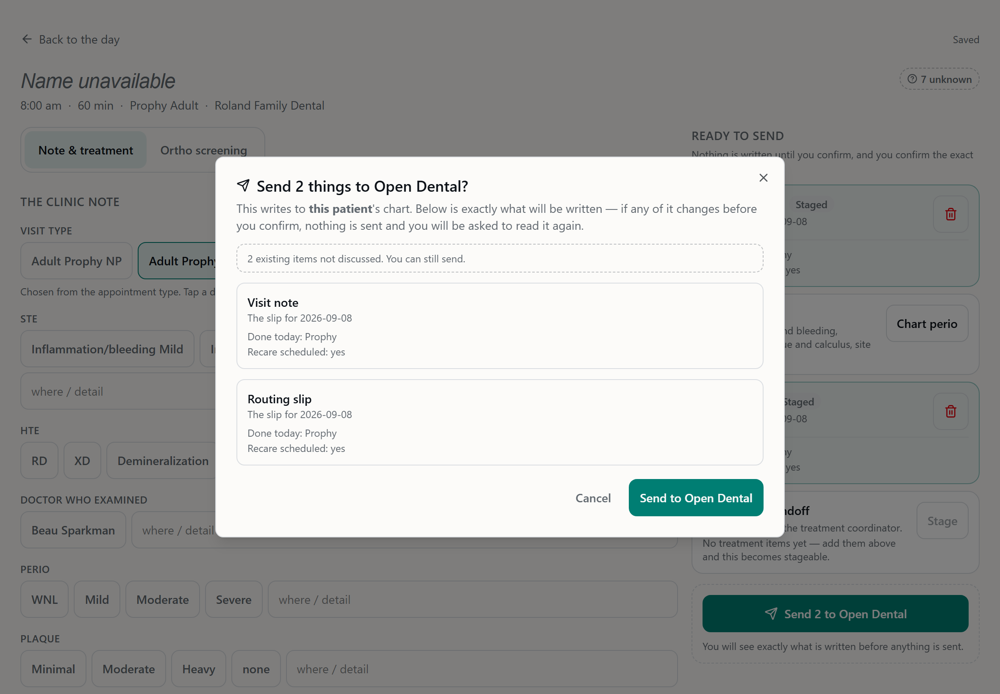
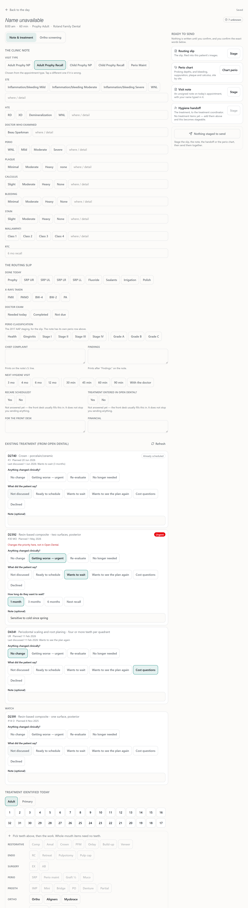

# Hygiene Slice 2a: existing treatment dispositions

Branch `feature/hyg-existing-tx`, cut from `origin/develop` at `942603f`. Worktree
`C:\Users\beau\carein-wt\hyg-existing-tx`. The PR targets develop and is **not merged**.

## What it does

The visit page's **Note & treatment** tab now has an **Existing treatment (from Open Dental)**
section. It sits directly above "Treatment identified today" and lists the patient's
treatment-planned procedures.

Each row shows:
- the code and description, tooth and surface, and planned date;
- an **Already scheduled** badge when Open Dental shows the procedure on a Scheduled
  appointment;
- a **Last discussed …** line;
- two tap questions: *Anything changed clinically?* and *What did the patient say?*
  - **Wants to wait** reveals timeframe chips.
  - **Getting worse → urgent** puts a red **Urgent** pill on the row, with the line
    "Changes the priority here, not in Open Dental."
- an optional note.

The answers are stored in CareIN only. Send's confirm shows a non-blocking reminder,
"N existing items not discussed", and Send stays enabled.

## Open Dental read (GET only)

| Rule | How it holds |
| --- | --- |
| Office and PatNum come from the stored visit | Both routes load the `hyg_visit` row by `(office, aptNum)`. The office and PatNum used are that row's. No parameter names a patient. With no visit row, the routes return 404 `VISIT_NOT_FOUND` and make no OD call. |
| Fail closed per office | `resolveHygOd(visit.office)` then `assertOfficeMatch`. An office that isn't ready returns 503 `OFFICE_NOT_READY` and makes no OD call. |
| Reuse the TC reader | `odReads.getTpProcedureRows` was extracted from `getCobProcedures` with no behaviour change. It is the same `/procedurelogs?PatNum&ProcStatus=TP` sweep with the same capability fallback. COB keeps its own `ProcFee > 0` filter. The TC tests pass with no expectation edits (75/75 in the four suites that use the reader). |
| Per item | ProcNum, code, description, tooth or surface, DateTP, OD priority name, and scheduled. **No fee** leaves the server. |
| "Already scheduled" | Claimed only when the procedure's AptNum appears in a `/appointments?PatNum&AptStatus=Scheduled` read, never from `AptNum > 0` alone, which can be a broken appointment. That read is made only when some procedure is attached to an appointment. |
| Watch grouping | The `priority` name from OD, trimmed, compared case-insensitively to exactly `watch`. A DefNum with no name, a description containing "watch", or `Watchlist` is not Watch. Everything else is one list, newest DateTP first, with unknown dates last. |
| Throttle and cache | Reads go through the office's own client, so they use the shared OD pacer, with hyg's 30s per-call timeout. One read on visit open, plus Retry/Refresh with `refresh=1`. The server cache holds for at most 10 minutes, keyed `(office, visit_id, pat_num)`. Two concurrent reads share one OD request. A failure is never cached. |
| Honest failure | A failed read returns 502 `OD_READ_FAILED`, "Couldn't load existing treatment from Open Dental", and no `items` key. The screen shows that sentence with Retry. It never shows an empty list. |
| Audit | On every successful GET, cache hits included, the route writes `hyg_existing_tx` plus `hyg_existing_tx_patient` (PatNum) before the body is sent. If the audit write fails the route returns 500 `AUDIT_FAILED` and no plan. The PUT writes `UPDATE hyg_existing_tx` with `source_ref proc_num:N`. Refusals are audited best-effort, the same way `visit.js` audits its refusals. |

## Storage: `hyg_existing_tx_disposition` (migration `1792800000000`)

The columns and CHECKs are as specified.
- The office CHECK applies, and the composite FK `(visit_id, office) → hyg_visit` means the
  office cannot cross. `UNIQUE (office, visit_id, proc_num)`.
- `pat_num` and `proc_num` must be greater than 0. `proc_snapshot` must be a jsonb object
  built from the **server's** read.
- Every nullable CHECK states its NULL case. `wait_timeframe` is allowed only when
  `patient='wants_to_wait'`.
- There is a role-guarded CRUD grant to `carein_app`, and an index on
  `(office, pat_num, proc_num)` for "last discussed".
- The timestamp was re-checked against `origin/develop` just before pushing. Develop's newest
  is `1792700000000`.

`existingTxSchema.test.js` checks that the CHECK lists the migration actually emits match
`shared/hyg/existingTx.ts`.

**PUT /api/hyg/visit/:aptNum/existing-tx/:procNum**
- The body is strict zod: `{clinical, patient, waitTimeframe, note}`. A body that includes a
  `code` gets 400.
- A procNum that is not in this visit's own read for its office and PatNum gets 404
  `PROC_NOT_IN_PLAN`.
- A frozen visit gets 409 `EXISTING_TX_FROZEN`.

**Frozen.** Answers freeze once the visit's `router` or `note` write is Sending, Written,
Failed or Amending. That is the slip's own rule: the write has left Draft/Staged. A sent
perio chart or TC handoff alone does not freeze them.
- The guard runs inside the upsert itself. A CTE takes `FOR SHARE` on the visit's router and
  note rows, so a send that is mid-commit is waited on and its state re-read.
- Rehearsed on Postgres 16 as `carein_app`. With an uncommitted Sending, the save waited and
  then refused. With a rolled-back send, the save landed.

**Last discussed.** For each ProcNum, the newest answer from an **earlier visit date**: same
office, PatNum and ProcNum, with `patient <> not_discussed`. The current visit and later
visits are excluded. A visit with no date gets no line.

## Deviations and decisions

1. **The vocabulary lives in `shared/hyg/existingTx.ts`, not inside `contract.ts`.** That is
   the module's own pattern: `orthoScreening.ts` and `perio.ts` are separate files that the
   bundle entry exports alongside `contract.ts`. `contract.ts` says explicitly not to
   re-export them, because a name exported twice breaks esbuild. The new error codes
   (`INVALID_PROC_NUM`, `PROC_NOT_IN_PLAN`, `EXISTING_TX_FROZEN`) are in `contract.ts`. The
   test pinning the CHECKs to the vocabulary is as asked.
2. **"Sent" means the note or slip has left Draft/Staged**, as described above. `Amending` is
   included because it is reached only from Written.
3. **Before a visit row exists**, the section shows **Show existing treatment**. That button
   starts the visit (the same idempotent `open`) and then reads. A plain GET of the page still
   never creates a visit row.
4. **The 10-minute cache also backs the PUT's plan check and `proc_snapshot`**, so a chip tap
   costs no OD call. A procedure added in Open Dental within the last 10 minutes appears after
   Refresh.
5. **The Watch rule depends on OD returning the priority *name* in lowercase `priority`.** OD's
   docs show that field, but no live staging response for this field has been captured yet.
   If it is absent, nothing is grouped as Watch, which is the "never guess" outcome. That is
   worth one look on staging.

## Out of scope, not touched

There are no auto-note lines, no Router/slip PDF section, no TC or checkout changes, and no
change to `stagedWriteComposer` or `sendVisit`. There are **no Open Dental writes**:
- `hygNoOdWrites` covers both new routes end to end against the throwing client.
- The source scan names the new files.
- A new test asserts that `routes/tc/odReads.js` names no write transport.

## Review

A fresh-context reviewer ran two rounds. Round 1 found no leaks, plus 3 MEDIUM findings and
several LOW ones. All three MEDIUMs and the two LOWs below are fixed in `1cdf631` and the
final commit.

The three MEDIUM findings:
- **The freeze could race a send mid-commit.** Fixed with the `FOR SHARE` CTE.
- **`Amending` didn't freeze.** Added to the frozen states.
- **Note then chip lost the note or the tap.** Fixed with per-row ordered saves that merge onto
  the latest answer sent. Chips stay tappable during a save.

LOW findings fixed:
- **Visit-change and stale-read guards.** Answers from a previous visit or an older read are
  dropped.
- **In-flight dedupe.** Two cold reads of one visit share a single OD request.

Round 2 was clean, with two minor items.
- **Fixed:** Refresh is disabled while a save is in flight.
- **Checked:** the reviewer's deadlock question. No hyg code takes an explicit lock or opens a
  transaction.
- **Left:** a queued save after a freeze repeats the same harmless 409.

LOW findings accepted:
- The PUT audits after the write, the same as every other hyg mutation.
- At the 500-entry cap the cache clears whole.

## Tests

```
backend  node --check server.js     ok
         node --test                 tests 4221, pass 4218, fail 0, skipped 3
           hygExistingTx.test.js     16/16  (office isolation, 404 not in plan, frozen 409 incl. the
                                             in-statement re-check, OD failure ≠ empty + not cached,
                                             office not ready, audit fail-closed, Watch only on the
                                             name, last-discussed earlier-only, cache + concurrent dedupe,
                                             snapshot from server, body validation)
           existingTxSchema.test.js   6/6   (CHECK lists = contract, NULL cases, FK/unique, grant,
                                             sort order, replayed columns)
           hygNoOdWrites.test.js     +2 cases
dashboard pnpm run check (tsc)        clean
          pnpm run test               Test Files 189 passed | 38 skipped; Tests 2911 passed | 219 skipped
           hyg-existing-tx.test.tsx  21/21  (placement, rows, Watch group, empty, no nested
                                             interactive + min-h-11, failure + Retry, start-then-read,
                                             Not discussed styling, read-back, wait timeframe, Urgent,
                                             note blur, note-then-chip ordering, frozen ×3, Send reminder)
real Postgres 16 rehearsal (as carein_app): casts, upsert, office isolation, last-discussed,
         freeze incl. a concurrent uncommitted send and a rolled-back one, every CHECK, the
         office-carrying FK, down + re-up.
```

One full backend run on Windows showed a single failure that did not reproduce. Every rerun
was clean. It matches the known Node 22 test-runner decode flake.

## Screenshots

The shots are 1180 wide, in light and dark. The visit page is taller than one screen, so the
section shots use a taller frame.

| Shot | Shows |
| --- | --- |
| `hyg-existing-tx-01-answered-1180x4300` | Every row state: Already scheduled with Last discussed, Urgent with wait timeframe and a note, a picked answer, Not discussed (dashed), and the Watch group |
| `hyg-existing-tx-02-unavailable-1180x2400` | A failed read: the sentence and Retry, with no list |
| `hyg-existing-tx-03-confirm-1180x820` | Send's confirm with "2 existing items not discussed. You can still send." |
| `hyg-existing-tx-04-locked-1180x4300` | A sent visit: locked notice, chips disabled |



