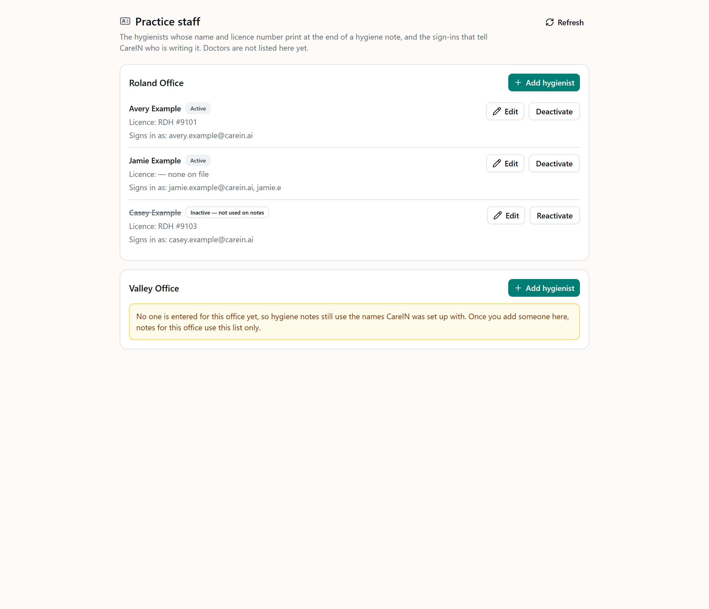
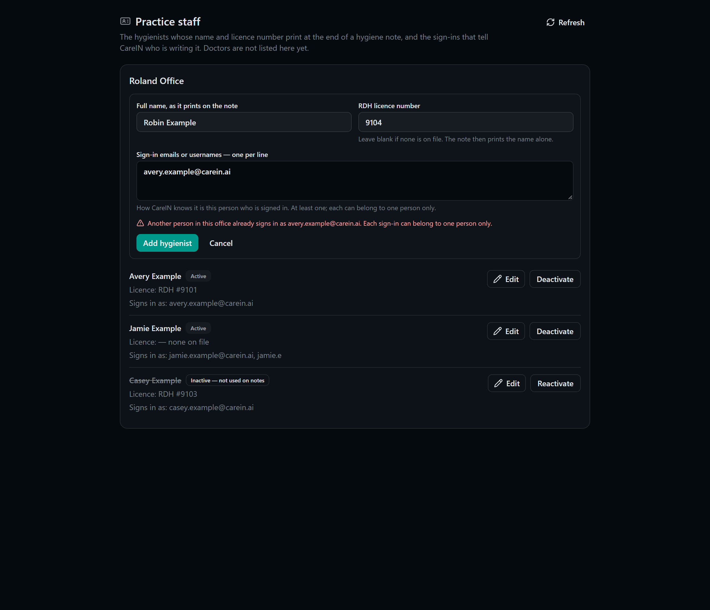
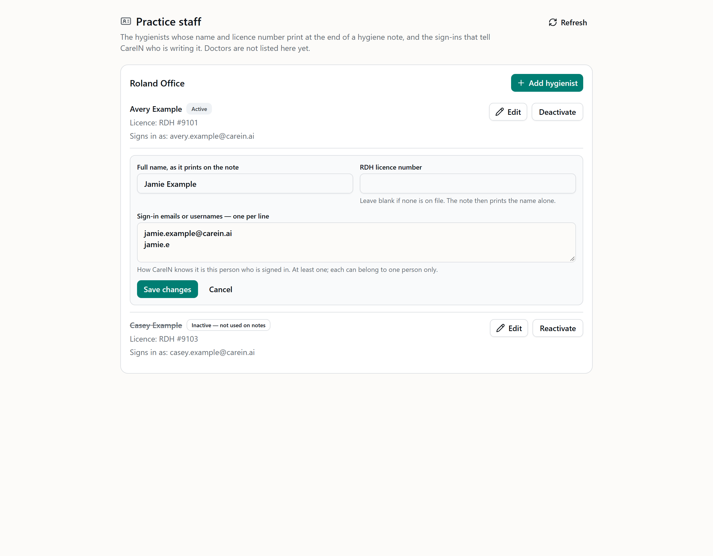

# Practice staff page (hygienists) — report

Branch `feature/platform-staff-settings` → `develop`. PR #286. Not merged.

The office manager now enters the hygienists whose name and licence number print at the end of a
hygiene note, per office, on a **Practice staff** page beside **Users**. Doctors stay in config.
`backend/config/hygStaff.js` stays too, as the fallback for an office with nobody entered yet, so
nothing about today's notes changes until someone enters data.

No Open Dental read or write anywhere in this change. Staff data only; no PHI.

## What changed

### Storage — `hyg_staff` (migration `1793400000000_hyg_staff`)

Additive, one new table, above develop's newest (`1793300000000`) at push time.

| Column | Rule |
| --- | --- |
| `id` | uuid primary key |
| `office` | NOT NULL, `CHECK (office IN ('roland', 'valley'))` |
| `full_name` | NOT NULL, not blank, ≤ 120 |
| `license` | NULL means "none on file"; a blank string is refused, so `""` can never print `RDH #` |
| `sign_in_ids` | jsonb array, 1–10 entries, lowercased; **unique per office across all rows, active or not** |
| `active` | default true; deactivate, never delete |
| `created_by/at`, `updated_by/at` | set by the server from the session |

- **No unique name.** Two staff may share a name. What identifies a row is its sign-ins, and every
  row needs at least one.
- **Sign-in uniqueness is enforced twice.** The route's insert and update refuse an overlap in the
  same statement that writes. A trigger is the backstop for two saves racing: it takes a
  per-office advisory lock, then checks with a fresh snapshot, and raises
  `23505 hyg_staff_sign_in_ids_unique`, which the store maps to the same 409.
- **No DELETE grant.** The app role gets SELECT, INSERT and UPDATE only, so "no hard delete" is a
  property of the database, not only of the routes.

**Rehearsed on real Postgres 16** (docker, `up` → checks → store SQL → race → `down`): all four
CHECKs refuse; an overlapping sign-in is refused in the same office and allowed in the other; an
edit that would take another row's sign-in is refused. Two concurrent transactions inserting the same
sign-in: the second blocks on the lock, then is refused `23505 hyg_staff_sign_in_ids_unique`.
`down` is clean.

### Routes — `/api/platform/hyg-staff`

| Route | Does |
| --- | --- |
| `GET ?office=` | this office's hygienists, active first, plus `usingBuiltInList` (true while the office has no rows) |
| `POST ?office=` | add |
| `PUT /:id?office=` | change name, licence, sign-ins |
| `POST /:id/deactivate?office=` / `POST /:id/reactivate?office=` | active false / true. There is no delete route. |

- **The gate is the Users page's,** `requirePermission('admin.all')`. It is mounted in `server.js`
  **above** the super-admin `/api/platform` mount, so this one path answers the office manager and
  every other `/api/platform` path still needs a super admin. A hygienist or the front office gets
  403 before any handler runs. `moduleGateWiring.test.js` now pins the gate, the absence of a module
  guard, and the ordering.
- **The office** is `?office=`, validated by the hygiene module's own `requireOffice` against the
  frozen keys, and named in every WHERE clause. A body that names an office is refused (the schema
  is strict), and a row id from the other office reads as not found.
- **Audit: one row per write, refusals included,** in the practice's own log:
  `resource_type 'hyg_staff'`, `resource_id` the row id, `office`, and `prior_state` saying what the
  write replaced. Create → NULL; edit → `edited:<fields>` (`name`, `licence`, `sign_ins`);
  deactivate → `active`; reactivate → `inactive`. Slugs only — never the name, licence or sign-in,
  which the `prior_state` CHECK would refuse anyway.
- **Honest states:** every write answers with the row as read back. A row that cannot be read back
  is `500 SAVE_NOT_CONFIRMED`, never success.

### The note — which call sites changed

One call site reads the hygienist roster, and it is the only one that changed:

- `backend/routes/hyg/visit.js` — staging a **note** now reads this office's rows
  (`staffStore.signatureRoster`) inside the same tenant connection and hands them to
  `signatureFor` → `hygStaff.signatureBlock`. Other staged kinds do not read it (they print no
  typed-name line).
- `backend/config/hygStaff.js` — `signatureBlock` takes that roster. `null` (no rows for the office)
  falls back to the config list. Once an office has **any** row, the table is the whole answer: an
  inactive row is not matched, and the config list is not consulted, so a deactivated person cannot
  reappear from config. Table rows match on **sign-in only** (`matchName: false`), because names may
  repeat and sign-ins may not. Credential is `RDH`.
- Unchanged: doctors (`supervisingDoctors`, `doctorOptions`) still come from config, and the
  "licence missing → full name only" rule is the same `personLine`.

### The page — `/admin/staff`

Beside **Users** in the nav, under `/admin`, so it inherits `admin.all` exactly as Users does.

- **Scoped to the app's office picker.** All offices shows one section per hygiene office; one
  office shows its own. Nothing on the page asks for an office.
- Each person: name, `Licence: RDH #…` or `Licence: — none on file`, `Signs in as: …`, and a status
  in words (`Active` / `Inactive — not used on notes`). Edit and Deactivate/Reactivate are labelled
  buttons, so no meaning lives in a hover or a colour.
- **An office with nobody entered says so:** notes still use the names CareIN was set up with,
  until someone is added.
- Add and edit are inline forms with the same three fields. A refusal shows the server's own
  words, and the form keeps what was typed. A row shows as saved only from the server's answer.

**Screenshots** (synthetic staff; dark versions beside each file in `docs/screenshots/platform/`):

All offices. Roland has three hygienists: one with no licence on file, one inactive. Valley has nobody entered yet, so it still uses the built-in list.



Adding someone whose sign-in another person in the office already holds. The refusal is the server's own words, and the typed values are kept.



Editing a row inline:



To regenerate: `pnpm exec vite build`, then `STAFF_SHOTS=1 pnpm exec vitest run tests/admin-staff-shots.test.tsx`, then `node scripts/shoot-staff.mjs`.

### Synthetic roster cleanup

Every real staff name used as test data, fixture value, assertion or full-name mention in tests,
fixtures and reports is now synthetic:

| Was (role) | Now |
| --- | --- |
| the three configured doctors | Drew Example, Morgan Example, Quinn Example — DDS #9001–9003 |
| the two configured hygienists | Avery Example, Jamie Example — RDH #9101, #9102 |
| staff first names, emails and a surname used as test values | Avery / Jamie / Drew, `*.example@carein.ai`, "Sampleton" |

- **59 test, fixture and report files**, plus the **12 RCM 835 corpus files**, whose rendering
  provider segment (`NM1*82`) is swapped byte-for-byte. Line endings and every other byte are
  unchanged, and the RCM suites still pass (1,257 / 0).
- **Tests that print through the config lists** (`hygStaff.test.js`, `feedbackRound1.test.js`,
  `hygFeedbackRound1.test.js`, `autonoteParity.test.js`) swap in the synthetic roster through
  `hygStaff.setRosterForTests`, defined once in `backend/config/hygStaff.fixture.js`. The few tests
  that check the *shipped* lists' shape still run against them and assert structure only.
- **Every assertion keeps its meaning.** The same people are compared, under new names.
- **Three report sentences were reworded,** not swapped, where a synthetic name would misdescribe
  what happened (a real sign-off, the names of two real auto notes).

## Guardrails

| Rule | How it held |
| --- | --- |
| No Open Dental reads or writes | none added; the page, route and store touch only `hyg_staff` and `audit_log` |
| No SELECT * | every statement names its columns |
| Migration additive, above develop's newest | one new table, `1793400000000` > `1793300000000` |
| Office server-derived | `?office=` validated against the enum; body cannot name one |
| Hygienists cannot edit | `admin.all` at the mount; 403 pinned for `hygiene` and `office` roles |
| No real patient or staff names in new code, tests, fixtures, report, PR, commits | synthetic roster throughout; fixtures roland 12827 |
| TS strict, no `any`, tsc clean | `pnpm run check` clean |
| Config file stays | `backend/config/hygStaff.js` kept as the fallback |
| Existing expectations unchanged except roster swaps | no other expectation edits; no `RULING (staff page)` edits were needed |
| `.env` / PROD folder | not read, not touched |

## Review

A fresh-context reviewer ran two rounds.

**Round 1: no critical or high findings.** The reviewer checked and confirmed the gate and mount order, the fallback rule (an office whose rows are all inactive does not fall back), the audit vocabulary against the `prior_state` CHECK, office scoping in every statement, the absence of DELETE, the trigger's race semantics, and that the roster swaps keep each assertion's meaning.
- **M1, already covered.** "The SQL and trigger have never run on real Postgres." They had: the PG16 rehearsal above, including the two-connection race.
- **M2, fixed.** A save whose audit row then failed answered with the generic `AUDIT_FAILED`, which reads as "nothing happened" though the row had landed. It now answers `SAVED_AUDIT_FAILED`: "The change was saved, but its audit entry could not be written…". Tested.
- **M3, fixed.** `setRosterForTests` was an inert production export. It now refuses to run under `NODE_ENV=production`. Tested.
- **L1, fixed in tests.** Three TC tests still used a real staff sign-in handle as a `diagnosingProvider` value; swapped. The reviewer also listed real names in *code comments*, an old migration, a staging script and non-report docs. Those are outside "tests, fixtures and reports" and are listed under For Beau.
- **L2, tested.** A padded, mixed-case session email still matches its stored sign-in.
- **L3, kept.** A 404 on another office's id is audited with that id. Nothing leaks.

**Round 2: approved.** It confirmed each fix and found nothing new. Its one optional note was that the new code's message must reach the screen. It does: the client shows the server's `error` text verbatim.

## Tests

```
backend   node --check server.js               ok
          node --test                          tests 4401, pass 4398, fail 0, skipped 3
           routes/hygStaff.test.js         17  role gate (hygiene + office 403), office enum, add normalises and
                                               keeps no placeholder licence, required fields + strict body, edit /
                                               deactivate / reactivate with one audit row each and what changed (no
                                               typed text in the trail), sign-in unique per office + free across
                                               offices + held by inactive rows, the trigger backstop, office
                                               isolation, read-back honesty, saved-but-unaudited, the note: config
                                               fallback, table wins + deactivation unmatches, missing licence prints
                                               the name only, shared names told apart, other office's row never
                                               prints, padded email matches, seam refuses production
           test/moduleGateWiring.test.js   +1  the new mount's gate, no module guard, ABOVE /api/platform
          RCM suites after the corpus swap      1257 pass, 0 fail
dashboard pnpm run check (tsc)                  clean
          pnpm run test                         Test Files 198 passed | 41 skipped; Tests 3013 passed | 231 skipped
           admin-staff.test.tsx             7  scoped to the office picker, words for a non-hygiene office,
                                               "— none on file", statuses in words, built-in-list notice, add sends
                                               the picker's office, refusal verbatim + typed values kept, edit and
                                               deactivate shown from the server's answer
           admin-staff-shots.test.tsx       3  screenshot dumps (STAFF_SHOTS=1)
postgres  PG16 rehearsal (docker)               up, 4 CHECKs, store SQL, overlap per office, race -> 23505, down
```

Node 22 sometimes shows a file-level `not ok` on an untouched file (`sendToTc.test.js`). It passes alone. It is the known runner flake; the final full run above has 0 failures.

## For Beau

1. **Older report screenshots still show real names.** About 180 PNGs under `docs/screenshots/`
   were rendered from the hygiene and RCM shot fixtures this PR made synthetic, so the images show
   the old names (the visit form's doctor chips, the typed-name line, a provider column). I did not
   re-render them: they are evidence of what each slice looked like when it shipped, and re-rendering
   would replace that with today's screens. If you want them clean, the choice is re-render all of
   them or delete them; either is a small follow-up.
2. **Real names outside tests, fixtures and reports, left as is:** code comments in
   `backend/routes/tc/hygiene.js`, `client/src/pages/AccessRequest.tsx` and `shared/tc/contract.ts`
   (changing that one forces a TC bundle regeneration), a seed email in the merged migration
   `1786449600000_roles_spine.js` (migrations are history), `backend/scripts/inject-staging-mango.cjs`,
   and several older `docs/*.md` files. Say if you want a sweep of those too.
3. **Left as is, deliberately:**
   - `backend/config/hygStaff.js` keeps the real roster, as instructed, because it is the fallback.
   - `docs/hyg-autonotes/autonotes.json` is the practice's own Open Dental auto-note export, and the
     template parity test is built on it. Editing it would make it no longer that export.
   - Bare "Beau" in comments that attribute a ruling ("Beau's ruling …") names the product owner,
     not test data. Staff emails and names used as *values* were all replaced.
4. **To switch an office over,** the office manager adds that office's hygienists with the sign-in
   email each one uses. From the first row on, that office's notes print from the page only, so add
   everyone at once.
5. **The shared temp login** (`temp@carein.ai`) should not be entered as anyone's sign-in. A temp
   signed in that way prints the name she signed in with, which is today's behaviour.
