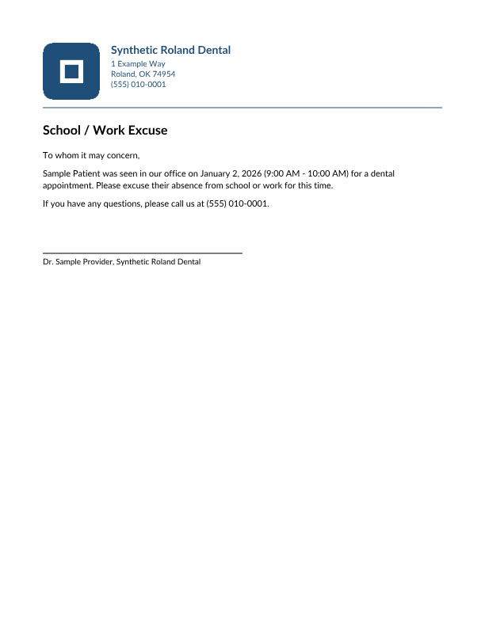
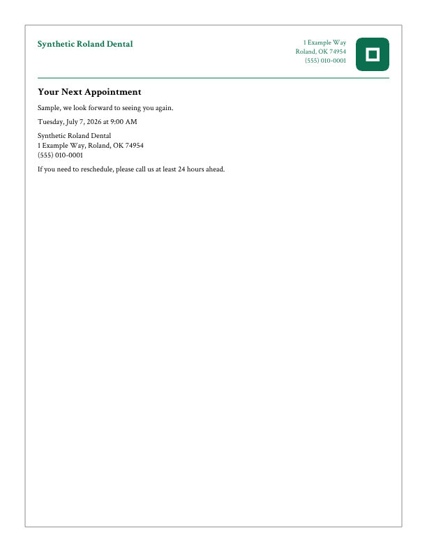
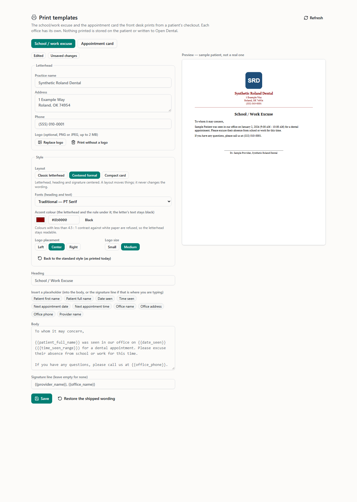

# CO-3b — Print template styling

Branch `feature/tc-print-styling` → `develop`. **Not merged** (develop merge hold).

Beau's ruling (2026-11-02): **curated options only, no free-form designer.** Each office styles each template on the existing Settings → Print templates page. The existing preview shows the change live, and the PDF applies it identically.

## What an office manager can choose

| Option | Choices | Default (today's printout) |
| --- | --- | --- |
| Layout | Classic letterhead · Centered formal · Compact card | Classic letterhead |
| Fonts (heading + text) | Standard (Helvetica) · Modern (Lato) · Traditional (PT Serif) · Serif headings, clean text (PT Serif + PT Sans) · Book (Crimson Text) | Standard |
| Accent colour | Any hex at or above 4.5 : 1 contrast against white | Black |
| Logo placement | Left · Center · Right | Left |
| Logo size | Small (48 pt box) · Medium (72 pt, the one inch CO-3 printed) | Medium |

- **Accent colour:** applies **only** to the letterhead text and the rule under it.
  - The heading, body and signature are always black. Readability is not configurable.
  - Picked with a colour picker or typed as hex.
  - A colour too light to read is named in the editor and Save turns off. The server refuses it too.
- **No logo uploaded:** the logo section is simply absent, whatever placement and size are chosen.
- **Layouts:** a layout moves blocks, never words. A test checks that every layout and font prints the same words in the same order.
  - **Classic letterhead:** CO-3's arrangement.
  - **Centered formal:** letterhead, heading and signature centered on the page. The body stays left-aligned.
  - **Compact card:** name on the left and contact details right-aligned on one band, tighter spacing, and a thin frame on every page.
- **"Back to the standard style (as printed today)":** a button that resets everything. Saving the standard style stores *no* styling (NULL).

### The readability floor

The server enforces the accent's floor as **4.5 : 1 contrast against white paper**. That is WCAG 2.x's AA threshold for normal-size text, and the letterhead's address and phone lines are 10 pt normal text.

In relative-luminance terms it is a **cap of L ≤ 0.1833**, since (1.0 + 0.05) / (L + 0.05) ≥ 4.5.
- `#767676` (4.54 : 1) is the lightest grey that passes, and `#777777` (4.48 : 1) is refused.
- Yellow, sky blue and white are refused.
- The refusal is named `PRINT_STYLE_ACCENT_TOO_LIGHT`, with the ratio in the message: "#ffff00 is too light to read on white paper (1.07 : 1; at least 4.5 : 1 is needed). Choose a darker colour."

## Fonts and licences

The four bundled families are fetched once from `github.com/google/fonts` (`ofl/…`). They are committed **unmodified** to `backend/assets/print-fonts/`, each with its licence text beside it.
- **No runtime fetching:** the PDF embeds the font. The preview loads the same files from the backend and registers them with the browser's FontFace API.
- **Embedding is allowed:** every file has OS/2 `fsType` 0. A test pins each file's SHA-256 to the upstream bytes.

| Family | Files | Licence | Copyright / Reserved Font Name |
| --- | --- | --- | --- |
| Lato | `Lato-Regular.ttf`, `Lato-Bold.ttf` | SIL Open Font License 1.1 (`OFL-Lato.txt`) | © 2010–2014 Łukasz Dziedzic; RFN "Lato" |
| PT Serif | `PT_Serif-Web-Regular.ttf`, `PT_Serif-Web-Bold.ttf` | SIL OFL 1.1 (`OFL-PTSerif.txt`) | © 2010 ParaType Ltd.; RFNs "PT Sans", "PT Serif", "ParaType" |
| PT Sans | `PT_Sans-Web-Regular.ttf` | SIL OFL 1.1 (`OFL-PTSans.txt`) | © 2010 ParaType Ltd.; RFNs "PT Sans", "ParaType" |
| Crimson Text | `CrimsonText-Regular.ttf`, `CrimsonText-Bold.ttf` | SIL OFL 1.1 (`OFL-CrimsonText.txt`) | © 2010 The Crimson Text Project Authors |

**The default stays Helvetica, unembedded, on purpose.** The ruling requires an untouched template to print exactly as before, and CO-3 printed the PDF base-14 Helvetica pair. Embedding a font there would change every shipped printout's bytes. Opting into any of the four bundled pairs gives the identical-on-every-machine output.

**Subsetting at embed time.** A one-page letter carrying a 650 KB Lato would be bloated, so `services/tc/printFonts.js` embeds each face subset to the characters it draws:
- Unused glyph outlines are emptied, glyph ids and the font's own cmap are kept, and the layout and kerning tables are dropped.
- Sample PDFs come out at 26–43 KB.
- The OFL FAQ treats subsetting a font to embed it in a document as permitted embedding. The bundled files themselves are never altered.
- A test checks that the subset is a valid TrueType program: tables, per-table and whole-font checksums, glyph ids, kept and emptied outlines, and determinism. pdf.js extracts the text from every embedded variant.

## How preview and PDF stay identical

**One layout engine.** `layoutPrintDocument` in `shared/tc/printStyling.ts` turns the composed printout and its styling into positioned operations in PDF points: text runs, rules, the logo box, and the frame.
- **The PDF:** `services/tc/printPdf.js` only serialises those operations.
- **The preview:** `PrintPreview.tsx` draws the *same* operations as an SVG page, 612 × 792 pt with y flipped.
- **Measurement:** both measure text with the same width tables. A backend test re-derives the tables from the bundled font files. The PDF's `/Widths` are those same numbers, and the SVG turns kerning and ligatures off so the browser advances glyphs as the PDF does.

**Tested from both sides:**
- **Backend:** for every layout × font pair, and every logo placement × size × layout, the PDF's content stream is parsed back and compared op for op with the engine. Geometry is asserted on the PDF itself:
  - a centered heading's midpoint is at 306 pt;
  - a right logo ends at the right margin, and a centered one is centered;
  - the logo box is 48 or 72 pt;
  - the compact card has its frame;
  - the colour sits only above the letterhead rule.
- **Frontend:** for the same matrix, every SVG element's coordinates, size, colour and font family equal the engine's op. A one-point shift in the preview fails both preview tests; I checked this by mutating the code.

## Defaults are today's printout, byte for byte

Before any code changed, `test/fixtures/printPdfPins.js` recorded the SHA-256 of the CO-3 renderer's PDF for five synthetic documents: both templates, a two-page body, a wide logo and a tall logo.
- **The pins:** `test/printStylingDefaults.test.js` holds the new renderer to those hashes with styling NULL, absent, spelled out as the defaults, and garbage. All five are byte-identical.
- **Separate geometry check:** the default page's geometry is also asserted against CO-3's constants, so a failure says *what* moved: 54 pt margins, the logo top-left with the letterhead 14 pt beside it, the heading 34 pt under the rule, 15 pt leading, and the 252 pt signature rule.
- **Through the route:** a stored template with NULL styling prints exactly the unstyled renderer's bytes.

## Storage

- **Migration `1794200000000_tc_print_styling`:** one nullable `jsonb` column `styling` on `tc_print_templates`.
  - No default and no backfill, so every existing row reads NULL, which is today's printout.
  - CHECK `styling IS NULL OR jsonb_typeof(styling) = 'object'`, two-valued.
  - The table's existing grant covers it.
  - Numbered above CO-3's `1794100000000`; re-checked against `origin/develop` at push time.
- **`PUT /api/platform/print-templates/:type/styling?office=`** with body `{ styling: {…} | null }`.
  - Gate: `admin.all`, like the rest of Settings.
  - The office comes from `?office=` (TC's `requireOffice`). The body names neither an office nor a type; an extra top-level key is `INVALID_BODY`.
  - **Closed schema, refused by name:** `PRINT_STYLE_UNKNOWN_KEY` (never silently dropped), `_INVALID_COLOR`, `_ACCENT_TOO_LIGHT`, `_UNKNOWN_OPTION`, `_MISSING_KEY`, `_NOT_AN_OBJECT`. A refusal stores nothing and writes no audit row.
  - **Audited like a wording save:** inside the save's transaction. `resource_type` is `tc_print_template` and `resource_id` is `<office>:<type>`. `prior_state` is `style_default` or `style_set`. If the audit write fails, the save is refused (`AUDIT_FAILED`).
  - **Read back** before answering; otherwise `SAVE_NOT_CONFIRMED`.
  - A type with no saved row gets one holding the shipped wording, as a logo upload does.
- **`GET /api/platform/print-templates/fonts/:file?office=`:** the preview's fonts.
  - Allow-listed to the contract's file names. Anything else is 404, including path tricks and the licence files.
  - Served as `font/ttf`.
- **Printing:** `routes/tc/checkoutPrint.js` passes the stored styling to the renderer. Nothing else in the print route changed: there is still no Open Dental call, and the audit row is still written before any PDF.

## Print flow

The workup's **Print** button generates the PDF, loads it into a hidden same-origin frame (an object URL), and calls the frame's `print()`. One click opens the browser's own print dialog on the PDF. The OS dialog is the printer surface; there is no printer management in the app.
- **Download PDF** is the secondary button.
- **Each press is its own printout,** so each writes its own audit row, as before.
- **If the browser will not print from the frame,** the dialog offers a link to the PDF instead. This covers an exception, or the PDF not loading within 15 s.
- **Frame lifetime:** the frame is removed when the object URL is revoked (5 min), or when the next print starts.

## Tests

New test files:

| File | What it pins |
| --- | --- |
| `backend/test/printStylingDefaults.test.js` | **Byte-stable defaults:** the five pinned CO-3 hashes, with styling NULL, absent, spelled-out defaults or garbage. Also the default page's geometry op by op, and the shared transliteration equalling `asciiSafe` for every code point. |
| `backend/test/printStylingFonts.test.js` | **The bundled files:** unmodified (upstream SHA-256), the OFL beside each, `fsType` 0, and nothing unlisted in the folder. The engine's width tables re-derived from the files. PostScript names. The subset's validity and determinism. |
| `backend/test/printStylingMigration.test.js` | **The migration:** one nullable jsonb column, the two-valued CHECK, a clean down, numbered newest, and the store reads the column. |
| `backend/routes/tcPrintStyling.test.js` | **Route refusals:** each code by name, with nothing stored and no audit row. |
| | **Saves:** `admin.all` gate; read-back; the audit trail (`style_default` → `style_set`); the standard style stored as NULL; fail closed on an audit failure; old rows read as defaults. |
| | **Office isolation:** roland's styling never reaches valley's settings or printout. |
| | **The PDF:** every layout × font pair and every placement × size × layout, content stream equal to the engine, with geometry asserted on the PDF. NULL styling through the print route prints the unstyled bytes. |
| | **The font route:** an exact allow-list. |
| | **Review round-1 fixes:** a rotated JPEG refused, the racing-first-save upsert, and a no-op reset that writes nothing. |
| `new-dashboard/tests/tc-print-styling.test.tsx` | **Schema refusals:** including the 4.5 : 1 boundary (`#767676` passes, `#777777` is refused). |
| | **Engine geometry:** for every layout, font pair, placement and size, including no overlap of logo and letterhead, and the same words for every layout and font. |
| | **The preview:** every SVG element equals the engine's op. |
| | **Settings:** the controls drive the preview, a too-light colour is named with Save off, a style-only save sends exactly the styling, and the standard style is sent as null. |
| | **Review round-1 fixes:** an uppercase hex is not a change, and a late frame load opens no dialog. |

Local runs on the final tree:
- `pnpm run check` is clean.
- `pnpm run test`: 206 files, 3,131 passed, 253 skipped, 0 failed. This is the pre-review count; the review round adds 2 frontend tests, and the post-review totals are in CI.
- `node --check server.js` is clean.
- Backend shard runner: 4,631 tests, 4,628 passed, 0 failed, 3 skipped.

Edits to existing tests, each labelled `RULING (CO-3b)`, all in `new-dashboard/tests/tc-print-templates.test.tsx`:
- **"Generate … opens the PDF" → "Print … opens the print dialog on the PDF":** it now asserts that the hidden frame loads the PDF and `print()` is called, and that no tab opens.
- **"a blocked tab leaves a link" → "a browser that will not print from the frame leaves a link":** the same link assertion, with the new trigger.
- **`afterEach`:** also removes the print frame, so one test's frame can't be found by the next.

No assertion was weakened.

## Samples (synthetic data)

One PDF per layout, with a synthetic letterhead ("Synthetic Roland Dental") and a synthetic logo mark:

| Layout | Fonts · accent · logo | PDF | Rendered |
| --- | --- | --- | --- |
| Classic letterhead | Modern (Lato) · `#1f4e79` · left, medium | `docs/reports/assets/co3b/co3b-sample-classic_letterhead.pdf` |  |
| Centered formal | Traditional (PT Serif) · `#8b0000` · center, medium | `docs/reports/assets/co3b/co3b-sample-centered_formal.pdf` |  |
| Compact card | Book (Crimson Text) · `#0b6e4f` · right, small (appointment card) | `docs/reports/assets/co3b/co3b-sample-compact_card.pdf` |  |

## Preview screenshots (synthetic data)

The screenshots are in `docs/screenshots/tc/co3b/`, light and dark at 1280 × 1800. Each is the Settings editor with the live preview, drawn in the real bundled fonts:
- `tccheckout-co3b-classic_letterhead-*`: Lato, logo left.
- `tccheckout-co3b-centered_formal-*`: PT Serif, logo centered.
- `tccheckout-co3b-compact_card-*`: Crimson Text, logo right.
- `tccheckout-co3b-accent-too-light-*`: `#ffd966` named as too light, with Save off.

## Review

Two rounds with a fresh-context reviewer.

**Round 1** found no blockers. The reviewer verified a lot by running code:
- **3,000 random documents** (Unicode, tabs, empty blocks, 1–40 px logos) rendered by the old CO-3 renderer and the new one: **0 byte differences**.
- **60 generated PDFs** (all pairs, layouts and logos, up to 4 pages):
  - pypdf in strict mode, poppler `pdftotext` and pdf.js parsed them with zero warnings;
  - every xref offset and object reference checked;
  - fontTools with `checkChecksums=2` passed on every subset;
  - composite glyphs (`Å`) draw;
  - Chrome's font sanitizer accepted every subset.
- **Preview text widths in Chrome** are within 0.3 % of the engine's measurement on kerning-heavy strings.
- **The print frame** loads and `print()` is callable in headless Chrome and Edge.

It raised five findings, all fixed in `6807b4b`:

| Severity | Finding | Fix |
| --- | --- | --- |
| should-fix | Typing the saved colour in capitals left the editor stuck on "Unsaved changes" | The typed hex is lower-cased; tested |
| should-fix | A phone JPEG with an EXIF rotation tag would lay out with width and height swapped in the preview (the browser rotates it) versus the PDF (stored pixels) | Such JPEGs are refused at upload, `LOGO_JPEG_ROTATED` ("stored sideways … save it upright or as a PNG"). No logo is stored in any environment yet, so nothing is stranded; tested |
| nit | A frame loading after the 15 s fallback could still open a dialog behind the link | The load handler returns once settled; tested with fake timers |
| nit | Two first saves racing could 500 on the primary key | One atomic `ON CONFLICT … DO UPDATE SET styling, updated_by, updated_at`, like `saveFields`; tested |
| nit | A reset to the defaults with nothing saved created a row | Nothing is written and nothing audited; tested |

**Round 2** confirmed all five fixes and found no regressions. On the EXIF parser specifically:
- **Byte order and segment order:** big- and little-endian TIFF, and EXIF after JFIF and XMP segments, all read correctly.
- **Robustness:** truncation at every length and 200,000 random corruptions gave 0 crashes and no hangs.
- **Failure direction:** a corrupt tag can only cause a named refusal, never a bad accept.

**Untested, no Firefox or Safari available:**
- **Firefox:** if its PDF viewer frame isn't scriptable, `print()` throws and the user gets the link.
- **iPad Safari:** it is known to print the page instead of the frame. That matters only if the desk prints from an iPad.

## CI

PR #307, run 41565957835, **passed on the first push.** It ran on `refs/pull/307/merge`, checked out as `391c36f Merge b9affd6… into bb7398f…`. That base is develop *after* PR #306 (the shard runner fix) merged.
- **Dashboard:** `pnpm run check` is clean, and vitest ran 206 files with 0 failures.
- **Backend:** the shard runner reported `TOTAL: 4634 tests · 4631 pass · 0 fail · 3 skipped` with all 4 shards green.

The migration number was re-checked against `origin/develop` after #306 merged. The newest tenant migration there is still `1794100000000`, so `1794200000000` stands.

**Not merged.** It is waiting for Beau to lift the develop merge hold.

## Not in this change

- **No printer management:** that's by the ruling.
- **No new infrastructure:** the logo container is still the CO-3 setup item.
- **Nothing for Open Dental.**
