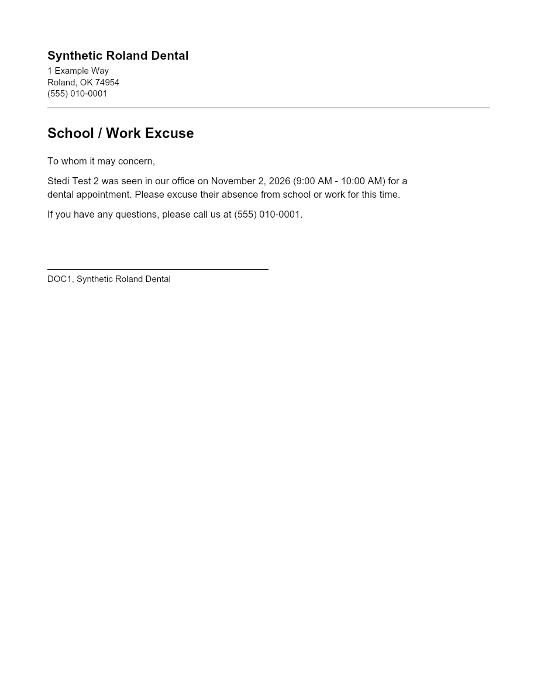
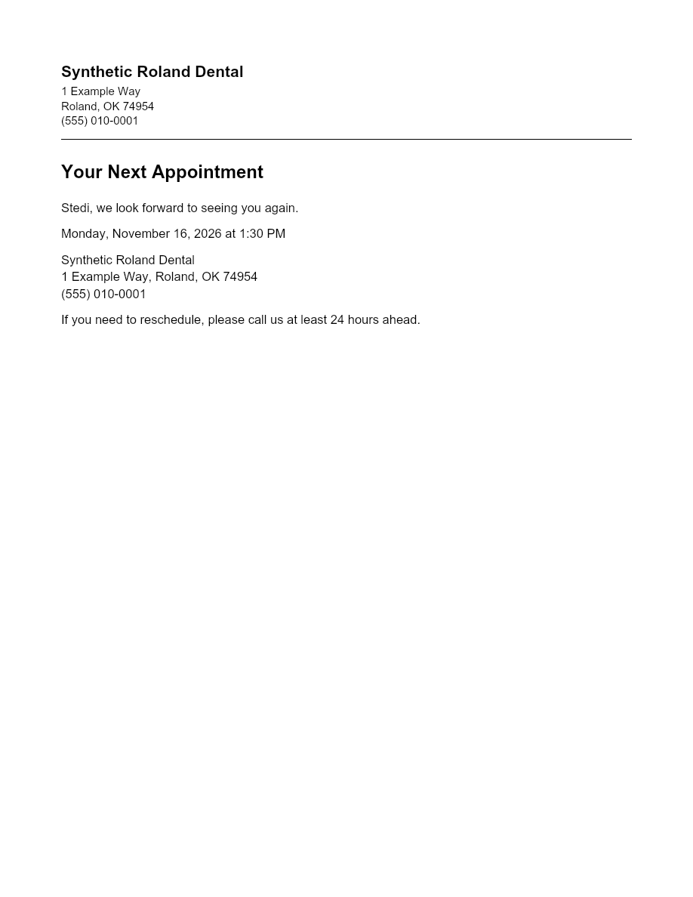

# CO-3 — Print templates

Branch `feature/tc-print-templates` → `develop`. Not merged.

Beau's rulings (2026-10-29 and 11-02):
- per office, editable by the office manager in Settings;
- shipped defaults;
- a closed placeholder menu;
- printed from the checkout workup;
- no manual import per practice;
- `/admin` is the hub, with no new nav tabs.

## What it is

**Settings → Print templates** (`/admin/print-templates`):
- **Access:** `admin.all`, the Practice staff page's gate; it is the third card on the `/admin` hub ("Print templates — School/work excuses and appointment cards"). The office comes from the app's office picker; "All offices" offers one office at a time.
- **What each office edits:** two templates, **School / work excuse** and **Appointment card**. Each has:
  - a letterhead (practice name, address, phone),
  - an optional logo,
  - a heading,
  - a body with placeholders,
  - a signature line (empty means none).
- **Letterhead prefill:** from the office's existing identity — Settings → Email identity's practice name and phone, else the app settings `TC_EMAIL_PRACTICE_NAME/PHONE/ADDRESS_<OFFICE>`, else the office label for the name.
- **Live preview:** beside the editor, drawn by the same composer the PDF uses (`composePrintDocument`), filled with clearly synthetic sample values: "Sample Patient", "Dr. Sample Provider", January 2, 2026. It is never filled with a patient.
- **Shipped defaults:** no saved row means the shipped wording, so an office that never edits still prints. "Restore the shipped wording" refills the form, and saving it stores it.
- **A third type:** it is one more entry in `PRINT_TEMPLATE_TYPES` (shared/tc/printTemplates.ts). The table stores the type as a slug with a shape CHECK, and the routes, tabs and print buttons all iterate the registry. Verified on real Postgres: a `referral_slip` row inserts with no migration.

**Printing** (the checkout workup, `tc.full`):
- **Where:** a **Print** section has one button per template.
- **The dialog:** shows the card's own **patient, date seen, provider and office** read-only, because the server takes them from the stored record, never from the request. Three values are editable, pre-filled where known:
  - **time seen**, from the schedule appointment's start (CO-5b);
  - **next appointment date and time**, from the Scheduled anchor (CO-4a).
  - An empty value prints as `__________`, a line to write on.
- **Generate:** returns a PDF, opened in a new tab for printing. If the browser blocks the tab, a link appears instead.
- **Nothing is stored** on the patient or the card, and nothing reaches Open Dental: there is no Open Dental call at all, and a test fails on any.
- **Each print writes an audit row before the PDF is sent:** `READ` / `tc_checkout_print` / the checkout's id / office / `source_ref template:<type>|patient:<PatNum>`, plus who and when. If that row can't be written, **no PDF is sent** (500 `PRINT_AUDIT_FAILED`).

## The placeholder menu (closed)

`patient_first_name`, `patient_full_name`, `date_seen`, `time_seen_range`, `next_appointment_date`, `next_appointment_time`, `office_name`, `office_address`, `office_phone`, `provider_name`.

- **Insertion:** the picker inserts them at the cursor, into the body or the signature line, whichever was last focused.
- **What a save refuses, by name** (the editor shows the same message live and turns Save off):
  - `PRINT_TEMPLATE_UNKNOWN_PLACEHOLDER` — e.g. `{{patient_dob}} in the body is not on the placeholder menu`;
  - `PRINT_TEMPLATE_MALFORMED_PLACEHOLDER` — a stray `{{` or `}}`;
  - `PRINT_TEMPLATE_PLACEHOLDER_NOT_ALLOWED_HERE` — a placeholder in the letterhead or heading, which are plain text.
- **What fills them:** the value object has exactly the menu's ten keys, and `fillPlaceholders` looks values up only by menu name. Even a token that somehow reached a stored template could not pull another field; a test shows `{{patient_dob}}` and `{{constructor}}` come through untouched.
- **Where the values come from:**
  - `patient_*`, `date_seen` and `provider_name`: the stored checkout row.
  - `office_*`: the office's template letterhead.
  - the three time values: the dialog.

## Logo

- **Upload pattern:** follows R4 referral attachments — managed identity, private container, no SAS, bytes only through the authenticated backend.
- **Storage:** `TC_BLOB_ACCOUNT_URL` (TC's existing account) and a **new container**, `TC_PRINT_ASSETS_BLOB_CONTAINER`, default **`print-assets`**.
- **Accepted files:** **PNG or JPEG only, ≤ 2 MB**. The type is sniffed from the bytes, never taken from the filename. A 16-bit or interlaced PNG is refused by name at upload, never half-drawn at print time.
- **The container does not exist in any environment, so uploading fails closed:**
  - With storage unconfigured, or a container-not-found from Azure, the upload answers **503 `PRINT_LOGO_STORAGE_UNAVAILABLE` "Logo storage is not set up for this environment. Nothing was saved; the template prints without a logo."**
  - The Settings page says the same thing up front and turns the upload off.
  - Templates and printing work fully without a logo.
- **Once storage exists:** the logo is drawn top-left of the letterhead. A logo that can't be read at print time is left off, and the response says so (`X-Print-Logo: omitted`, plus a notice). The printout doesn't depend on the logo.
- **This PR creates no infrastructure.**

### Setup to run, supervised, per environment

Each environment needs one container command and one role command. The role is Storage Blob Data Contributor on that container, for the app's managed identity. Principal IDs are from the verified list in the RCM Blob notes; the subscription is "Azure subscription 1".

```bash
# STAGING
az storage container-rm create --subscription "Azure subscription 1" -g rg-carein-staging --storage-account stcareinstaging -n print-assets --public-access off
az role assignment create --subscription "Azure subscription 1" --role "Storage Blob Data Contributor" --assignee-object-id 9a00e1f2-ba32-428e-96b4-d4e6566a812c --assignee-principal-type ServicePrincipal --scope "/subscriptions/<sub-id>/resourceGroups/rg-carein-staging/providers/Microsoft.Storage/storageAccounts/stcareinstaging/blobServices/default/containers/print-assets"

# PROD
az storage container-rm create --subscription "Azure subscription 1" -g rg-carein-prod --storage-account stcareinprod -n print-assets --public-access off
az role assignment create --subscription "Azure subscription 1" --role "Storage Blob Data Contributor" --assignee-object-id bad11401-a97d-4801-8f20-33889c15dcd6 --assignee-principal-type ServicePrincipal --scope "/subscriptions/<sub-id>/resourceGroups/rg-carein-prod/providers/Microsoft.Storage/storageAccounts/stcareinprod/blobServices/default/containers/print-assets"
```

- **The `<sub-id>` placeholder:** fill it from `az account show --subscription "Azure subscription 1" --query id -o tsv`.
- **The app setting:** no new one is needed, because `print-assets` is the default. Set `TC_PRINT_ASSETS_BLOB_CONTAINER` only to use a different name.
- **Prod's `TC_BLOB_ACCOUNT_URL`:** it must already be set for TC media. If it isn't, logos stay refused with the same message, which is the intended fail-closed state.
- **The verification gotcha** from those notes still applies: `az role assignment list -o table` shows the client ID, not the principal ID.

## Storage

- **Migration:** tenant migration **`1794100000000_tc_print_templates`**, above develop's newest, CO-5b's `1794000000000` (re-checked at push).
- **The table:** one new table, **`tc_print_templates`**:
  - primary key `(office_id, template_type)`;
  - the text columns bounded exactly as the contract bounds them (a test proves each limit is accepted and one character more is refused);
  - `logo_key` / `logo_content_type` all-or-none;
  - `updated_by` / `updated_at`.
- **Grants:** `carein_app` gets **SELECT, INSERT, UPDATE — no DELETE**; nothing removes a template.
- **Edits:** each one is audited inside its transaction (`UPDATE` / `tc_print_template` / `<office>:<type>` / prior_state `default` | `stored` | `logo_none` | `logo_set` — never the wording). Every save answers the template **as read back**; a mismatch is 500 `SAVE_NOT_CONFIRMED`.
- **No platform_setting row:** none is needed and none is seeded.

### Verified on real Postgres 16

Done with a throwaway script, not committed (output below). It ran the store's own SQL as `carein_app`, then migrated down and back up:

```
  ok   saveFields: insert then update, FOR UPDATE read, as carein_app
  ok   setLogo: inserts the shipped wording with the logo, then clears it
  ok   rowsFor: two roland rows, none in valley
  ok   refuses: an unknown office (23514)
  ok   refuses: a type that is not a slug (23514)
  ok   refuses: a logo key without a type (23514)
  ok   refuses: a logo that is a gif (23514)
  ok   refuses: a second row for the same office and type (23505)
  ok   refuses: a body over 4000 (23514)
  ok   refuses: DELETE as carein_app (42501)
  ok   a third type needs no migration: inserted referral_slip
```

**It found a real bug, fixed before push.** The first version of the logo CHECK accepted a logo key with a NULL type. `NULL IN (...)` is NULL, which makes the whole CHECK NULL, and Postgres lets a NULL CHECK pass. The CHECK now says `logo_content_type IS NOT NULL` explicitly, and the migration test pins it.

## The PDF

`services/tc/printPdf.js` follows `services/hyg/slipPdf.js`:
- **Hand-written:** no PDF library on the path.
- **Deterministic:** no /Info, no /ID, no timestamp.
- **WinAnsi text:** using the slip's own transliteration and escaping. `pdfEscape` is now exported from slipPdf; nothing was copied.

Additions over the slip: Helvetica-Bold, a rule under the letterhead, a signature line, page breaks for a long body, and the optional logo as an image XObject:
- **JPEG** is embedded as-is (`/DCTDecode`).
- **PNG** is decoded in `printImage.js` (zlib plus the five row filters; grey, RGB, grey+alpha, RGBA, and palette at 1/2/4/8 bits with tRNS), then re-deflated with any transparency as a soft mask.

**Samples** (synthetic data: the roland test PatNum 12827's synthetic name, letterhead "Synthetic Roland Dental"):

| | PDF | Rendered |
| --- | --- | --- |
| School / work excuse | `docs/reports/assets/co3/co3-sample-excuse.pdf` |  |
| Appointment card | `docs/reports/assets/co3/co3-sample-appointment_card.pdf` |  |

## Screenshots (synthetic data)

`docs/screenshots/tc/co3/`, light and dark:
- `tccheckout-co3-01-excuse-editor-1280x1500`: the editor, the menu, the "Logo storage is not set up" notice, and the live preview.
- `tccheckout-co3-02-card-editor-refusal-1280x1500`: the appointment card with `{{balance_due}}` named as off-menu, and Save off.
- `tccheckout-co3-03-print-dialog-1280x900`: the workup's Print section and dialog.

## Tests

| File | Count | Covers |
| --- | --- | --- |
| `backend/routes/tcPrintTemplates.test.js` | 22 | **Settings:** admin.all gate (tc, office, hygiene and doctor refused, nothing written); office keys; defaults render with the prefill and pass their own menu; unknown / malformed / letterhead placeholders refused by name with nothing stored; the renderer reaches nothing outside the menu; save read back and audited `default` → `stored` with no wording in the trail; office isolation; read-back mismatch is 500; audit failure rolls the save back. **Logo:** 503 with the exact message, with no storage and with a missing container; type and size limits; with storage, uploaded, audited, carried into the PDF, and left off with `omitted` when unreadable. **Printing:** tc.full gate; dialog defaults from the stored card and the anchor; **the PDF holds the filled values for the fixture card** (parsed with pdf-parse); a blank is a line; the body can't name a patient, office, provider, day or PatNum; **no PDF when the audit fails**; office isolation both ways; a saved template is what prints; nothing stored; no Open Dental call. **Review additions:** a zip-bomb PNG and an over-size one are refused by name; two racing first saves end as one row |
| `backend/test/printTemplatesMigration.test.js` | 7 | table and PK; type is a shape and every registry type fits; bounds equal the contract's; logo all-or-none (including the NULL hole); grants without DELETE; down; numbering; schema replay |
| `backend/test/moduleGateWiring.test.js` | +1 | the new mount is behind admin.all, has no module guard, and sits above `/api/platform`. Labelled RULING (CO-3); the repo's CLAUDE.md asks for new mounts to be added here. |
| `new-dashboard/tests/tc-print-templates.test.tsx` | 11 + 3 shots | preview on synthetic values only; picker inserts at the cursor; off-menu named, Save off; save and refusal; logo notice and upload error; print dialog fixed vs editable; Generate sends exactly the three values and opens the PDF; blocked tab leaves a link; audit refusal shown, nothing opens; a logo upload keeps unsaved wording and the caret lands after an inserted placeholder |
| `new-dashboard/tests/admin-hub-print-templates.test.tsx` | 2 | the third hub card and its link; the route inherits `/admin`'s admin.all |

- Only the one existing test file above was edited, and only by adding a test.
- **Mutation checks:** 12 deliberate code breakages each turn a test red. Among them:
  - the renderer reaching an off-menu name;
  - an unknown placeholder being saved;
  - a print body that isn't strict;
  - **the audit failing but the PDF still being sent**;
  - no print audit at all;
  - the card's office being ignored;
  - the validator, the read-back and the save audit being skipped;
  - an unbounded inflate;
  - a missing container read as success;
  - the prefill ignoring the office identity.
- **Full suites on the reviewed code:**
  - backend: 4,579 passed, 0 failed, 3 skipped (sharded);
  - dashboard: 3,106 passed, 0 failed;
  - typecheck clean.
- **The dark-mode contrast guard caught the preview's white paper.** The preview is now declared `bg-white dark:bg-white` with the text colour fixed dark, because a picture of a printout is white in either theme. The guard file was not edited.

## Not done, by ruling or scope

- **The optional CI-verify block:** skipped. The paste did not say "verify step approved", so `.github` is untouched.
- **Appointment card size:** it prints on US Letter like the excuse. A card-stock size is a renderer option for later.
- **Removing a logo:** stops printing it, but the stored blob is left in place; nothing is deleted.

## Review

A fresh-context reviewer ran two rounds.

**Round 1:** no blockers. The reviewer confirmed:
- the placeholder fill is single-pass and menu-only, so a patient name containing `{{...}}` stays inert;
- the print body is strict, and the row is loaded by the request's office;
- the audit is written after the PDF is built and before it is sent, with any throw giving a 500 and no PDF;
- the save audit is inside its transaction, and the gates hold;
- the PDF escaping and xref are correct.

**Round 1 should-fix items, all fixed with tests:**
1. **A zip-bomb PNG.** The inflate is now capped at exactly what the header claims, and anything more is refused as `LOGO_IMAGE_UNREADABLE`.
2. **An oversize synchronous decode.** Logos are capped at 2048 px a side, and prepared logos are cached by content hash; only good decodes are cached.
3. **A logo upload wiped unsaved wording.** The draft now resets only when the saved wording changes.

**Round 1 nits fixed:**
- the caret position after inserting a placeholder;
- long letterhead lines now wrap;
- a stored-but-unsaved logo's key is logged;
- two racing first saves are now one atomic upsert, never a 500.

**Round 2:** approved, with all fixes verified. I took its letterhead-width nit (more generous character widths).

**Left as is, and named here:**
- **Audit slug after a lost race:** if two first saves race, the loser's audit row says `prior_state=default` although it replaced a stored row. The window is milliseconds and only the slug is wrong.
- **Racing first logo uploads:** two simultaneous first logo uploads to a type with no saved row: the second gets a 500, and its blob key is logged.
- **A logo freezes the letterhead:** uploading a logo to a type with no saved row saves the shipped wording with today's letterhead. That template then stops following later changes to the office identity, as any saved template does.
- **JPEG variants:** a 12-bit or arithmetic-coded JPEG is embedded as-is and may render badly in a viewer. This is not a server risk.

## CI

_Below._
