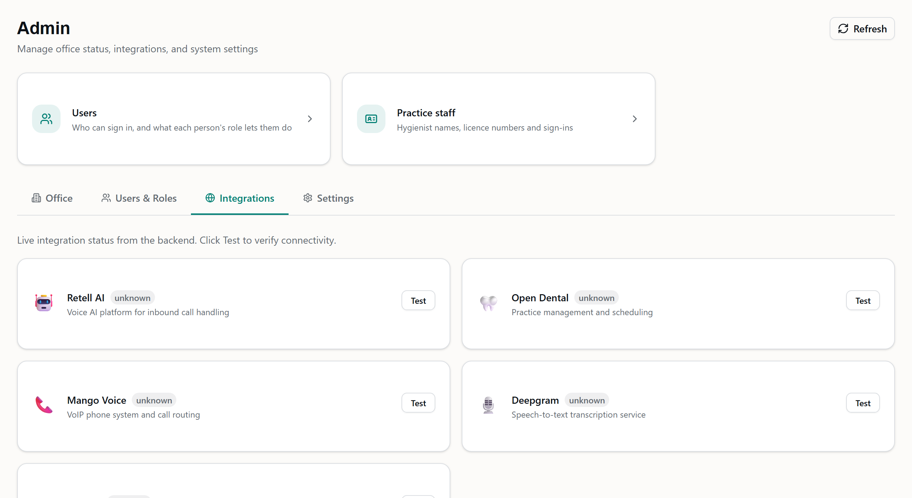
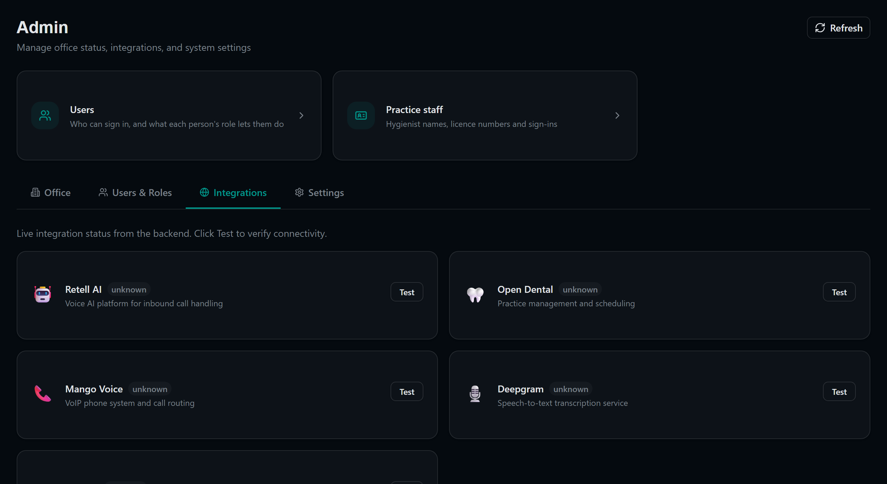

# fix/staff-settings-link — Practice staff linked from the Admin hub

Per Beau's ruling (no new nav tabs in any module; `/admin` is the hub), the Admin page
(`new-dashboard/client/src/pages/Admin.tsx`) now has a row of two linked cards just under
its header and above its tabs: **Users** ("Who can sign in, and what each person's role
lets them do") → `/admin/users`, and **Practice staff** ("Hygienist names, licence numbers
and sign-ins") → `/admin/staff`. The page had no Users entry, so a matching Users card was
added to keep the pattern consistent. Both cards use the page's existing office-card style
(icon tile, title, subline). The row sits above the tabs rather than inside "Users & Roles"
because the page opens on Integrations, so it shows whichever tab is open. On visibility:
the page itself does **no** permission check today. The whole `/admin` route is gated by
the `/admin` → `admin.all` prefix in `ROUTE_PERMISSIONS` (`lib/permissions.ts`), and
`App.tsx` redirects anyone without it to their home. Both cards inherit that gate, and both
targets sit under the same prefix. Nothing new was invented, and no nav item was added
anywhere; the voice nav's existing "Practice staff" item is unchanged. This is a display
change only, with no backend, contract or migration changes. The typecheck
(`pnpm run check`) is clean and the full dashboard suite passes (199 files, 3014 tests).
The only test change is a new `tests/admin-hub-links.test.tsx` that pins both hrefs and
labels; no existing expectations changed. Its `STAFF_SHOTS=1` mode produced the
screenshots below, from a synthetic render with no backend and no names. One thing for a
later slice: the "Users & Roles" tab still shows the old "User Management — Coming Soon"
placeholder even though `/admin/users` exists. It was left alone to keep this PR to a link.

